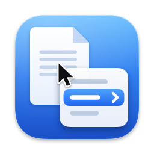
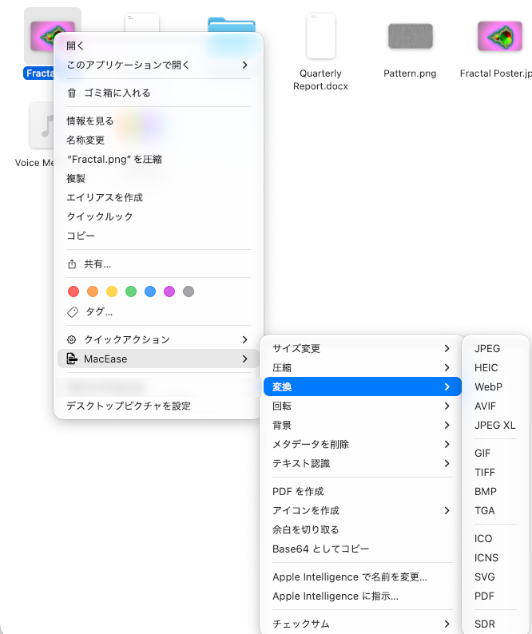
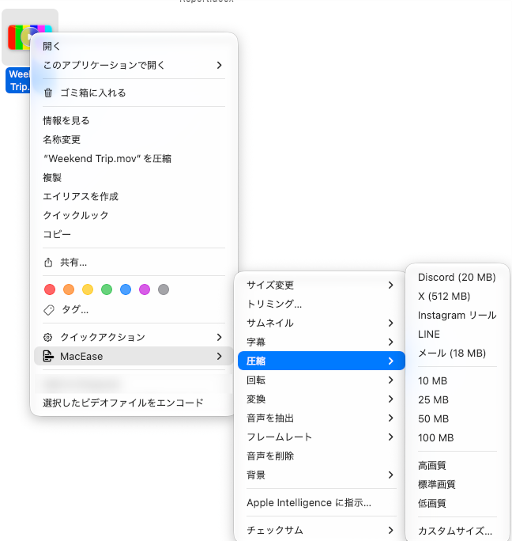
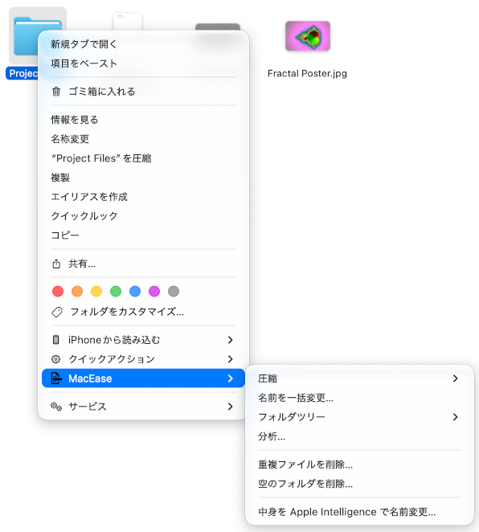
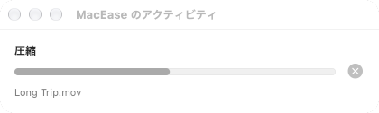
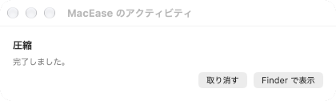
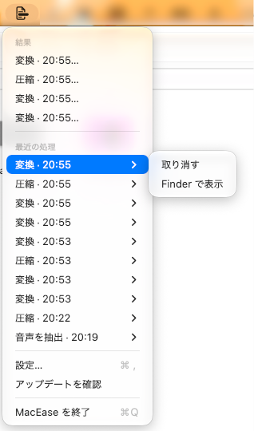
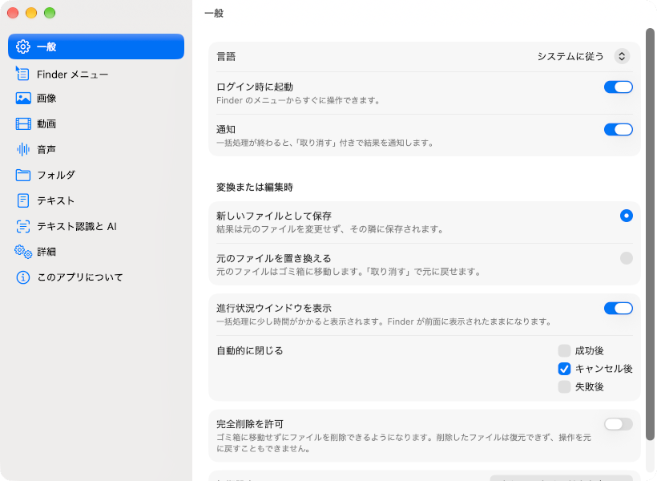
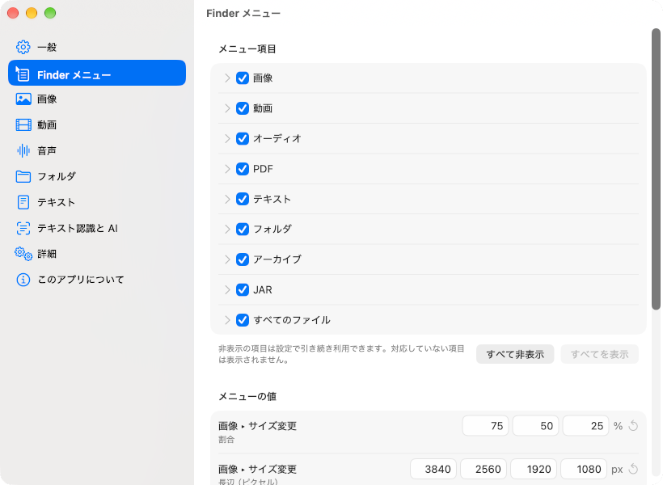

<div align="center">



# MacEase（マッキーズ）

**[English](README.md) | 日本語**

**右クリックするだけ。**

Finder の右クリックメニューから、ファイルやフォルダをそのまま変換・圧縮・編集できます。ほかのアプリを開く必要はありません。



</div>

---

## インストール

1. [Releases](https://github.com/TKY-27/MacEase/releases) から `MacEase-<version>.dmg` をダウンロードし、リリースページの SHA-256 チェックサムと一致するか確認します。
2. DMG を開き、**MacEase** を **アプリケーション** にドラッグします。
3. MacEase を開きます。Apple の公証を受けていないため、初回は macOS に起動をブロックされます。
4. **システム設定 > プライバシーとセキュリティ** を開き、下までスクロールして MacEase の横にある **このまま開く** をクリックし、確認します。
   または、ターミナルで次を実行します。
   ```sh
   xattr -dr com.apple.quarantine /Applications/MacEase.app
   ```
5. ようこそウインドウで Finder 拡張機能を有効にします。完了通知が必要なら通知を許可し、**完了** をクリックします。

リリースビルドは自己署名証明書で署名しており、Apple の公証は受けていません。[ソースからビルド](#ソースからビルドする) することもできます。

セットアップ後は、Finder でファイルやフォルダを選んで右クリックし、**MacEase** を選びます。**設定** はメニューバーの MacEase アイコンから開きます。MacEase を再度開くと、セットアップが完了するまではようこそウインドウ、その後は設定が開きます。

**設定 > フォルダアクセス** では標準フォルダと追加したフォルダを確認できます。ここや初回のようこそ画面から **フォルダを追加…** で登録し、アクセス確認やFinderでの表示ができます。登録とmacOSの権限は別で、一覧から削除してもアクセス権限は取り消されません。iCloud管理下でMacEaseメニューが表示されない場合は、Finderの **サービス > MacEaseで操作…** を使えます。右クリックメニューに直接表示される場合もあります。macOSのアクセス要求が待機したままの場合は、**フォルダを追加…** で対象を選び、MacEaseを再起動して再試行してください。この手順にフルディスクアクセスは不要です。

---

## 機能

**元のファイルは守られます。**

初期設定では、変換や編集の結果を新しいファイルとして元のファイルの隣に保存します。名前が重複する場合は番号を付け、上書きしません。書き出しや抽出では常に元のファイルを保持します。**設定 > 一般** で元のファイルを置き換えるように変更することもでき、その場合は出力を検証してから元のファイルをゴミ箱に移します。「取り消す」は作成した出力をゴミ箱に移すか、置き換えた元のファイルを戻します。変更されたファイルや、ゴミ箱から失われた元のファイルはスキップする場合があります。完全削除は初期設定でオフになっており、確認が必要で、取り消せません。

ファイルはいくつでもまとめて選べます。1 種類のファイルだけを選ぶと操作が直接表示され、複数の種類を選ぶと種類と件数でグループ化されます。プリセットや形式を選ぶとすぐに実行します。**…** で終わる項目は、入力、確認、レビューのためのウインドウを開きます。

### 画像

| 操作 | 内容 |
| --- | --- |
| **解像度・サイズ変更** | 割合や長辺のピクセル数で縮小。720・480・360pxや**カスタムサイズ…** を指定でき、低解像度プリセットでは拡大しません |
| **圧縮** | プラットフォーム別プリセット、画質の段階、または **カスタムサイズ…** の目標サイズ |
| **変換** | PNG、JPEG、HEIC、WebP、AVIF、JPEG XL、GIF、TIFF、BMP、TGA、ICO、ICNS、SVG、PDF。対応する HDR 画像は **SDR** にも変換 |
| **SVGにトレース…** | 静止 PNG と編集可能な SVG パスを比較。1〜8 色と 3 段階の細部設定を選び、新規ファイルに保存 |
| **回転** | 90° 単位の回転と、編集できる追加の角度。左右・上下の **反転** もここにあります |
| **背景** | 背景を削除するか、グリーン・ブルー・任意の色、またはぼかしに置き換え |
| **メタデータを削除** | すべて、位置情報のみ、または設定で選んだ項目を削除 |
| **テキスト認識** | 画像内の文字を読み取り、コピー、`.txt` として保存、または表示 |
| **PDF を作成** | 選んだ画像を 1 つの PDF にまとめる。複数のときはページ順を調整するウインドウを表示 |
| **アイコンを作成** | macOS の `.icns`、Windows の `.ico`、iOS の AppIcon セットを書き出し |
| **余白を切り取る** | 均一な余白を取り除く |
| **Base64 としてコピー** | 画像を `data:` URI としてコピー（初期設定では非表示） |

TGA への変換は、ImageIO が読み込みと書き込みに対応する環境で表示されます。PSD は保存済みの合成画像から PNG、JPEG、TIFF を書き出し、レイヤーを持つ元のファイルは保持します。読み込みに対応するカメラ RAW も元のファイルを保持します。SVG はパスのトレースか PNG の埋め込みを選べます。 **SVGにトレース…** は静止 PNG 1 枚を比較表示し、編集可能なパスを新しい SVG に保存します。ロゴや単色の図形に適しています。写真の忠実な再現、文字の再編集、グラデーションの復元は対象外です。保存前に表示されるメタデータ・透明度・HDR の警告を確認してください。

### 動画



| 操作 | 内容 |
| --- | --- |
| **解像度・サイズ変更** | 割合や短辺2160p・1080p・720p・480p・360pで縮小。**カスタムサイズ…** では指定した枠内に収めます |
| **動画を編集…** | 範囲・速度・解像度を一度の書き出しで変更。出力の時間・寸法・保存方式を確認できます |
| **再生速度** | 0.5・0.75・1.25・1.5・2・4倍と、0.5〜4倍の任意値を入力できる**カスタム速度…**。音程を維持し、複数動画にも適用できます |
| **サムネイル** | 最初、中央、または選んだフレームを画像として保存 |
| **字幕** | SRT、WebVTT、プレーンテキストに文字起こし、または翻訳した SRT を書き出し |
| **圧縮** | Discord、X、Instagram リール、LINE、メールのプリセット、固定の目標サイズ、画質の段階、または **カスタムサイズ…** |
| **回転** | 90° 単位の回転と、編集できる追加の角度。左右・上下の **反転** もここにあります |
| **変換** | MP4、MOV、M4V、MKV、WebM、AVI、FLV。GIF、アニメーション WebP、APNG。対応する HDR 動画は **SDR** にも変換 |
| **音声を抽出** | 音声を M4A（AAC または ALAC）、MP3、AAC、WAV、AIFF、FLAC、Ogg Vorbis、Opus で保存 |
| **フレームレート** | フレームレートを変更 |
| **音声を削除** | 音声トラックを取り除く |
| **背景** | 背景を透明・単色・ぼかしにした動画を書き出し |

### 音声

| 操作 | 内容 |
| --- | --- |
| **変換** | MP3、M4A（AAC または ALAC）、コンテナなしの AAC、WAV、AIFF、FLAC、Ogg Vorbis、Opus、CAF（PCM または ALAC） |
| **字幕** | SRT、WebVTT、プレーンテキストに文字起こし、または翻訳した SRT を書き出し |
| **圧縮** | ビットレートのプリセット、または **カスタムサイズ…** の目標サイズ |
| **ラウドネスを揃える** | 目標のラウドネスに合わせる |
| **トリミング…** | 指定した範囲だけを残す |

字幕には、Apple のオンデバイスの Speech・Translation フレームワークを使います。

### PDF

| 操作 | 内容 |
| --- | --- |
| **結合** | 2 つ以上の PDF を、選んだ順序で 1 つにまとめる |
| **画像として書き出す** | 各ページを PNG・JPEG としてフォルダ内や PDF の隣に保存するか、1 つの複数ページ TIFF に書き出し |
| **テキストとして書き出す** | テキストを保存。スキャンされた PDF には OCR を使用 |
| **圧縮** | PDF を小さくする |
| **回転** | すべてのページを回転 |
| **ページを抽出…** | 選んだページを新しい PDF として保存 |
| **ページごとに分割** | 1 ページずつ別の PDF として保存 |

### 文書とテキスト

| 操作 | 内容 |
| --- | --- |
| **変換** | リッチテキスト文書の書き出し、HTML・Markdown の描画、構造化テキストや字幕ファイルの変換（[変換できる形式](#変換できる形式) を参照） |
| **文字コード** | UTF-8、BOM 付き UTF-8、UTF-16、Shift_JIS に変更 |
| **改行コード** | LF または CRLF に統一 |
| **整形 / 1 行に圧縮 / キーを並べ替え** | JSON を整形。並べ替えでは比較方法、昇順・降順、優先するキー、単純な値の配列を並べ替えるかを指定可能 |

### フォルダ



| 操作 | 内容 |
| --- | --- |
| **圧縮** | フォルダを ZIP、7z、TAR、tar.gz にまとめる |
| **名前を一括変更…** | プレビューを見ながら中身の名前を変更 |
| **フォルダツリー** | フォルダ構成をコピー、またはファイルとして保存 |
| **分析…** | 選んだフォルダの容量をまとめて分析し、CSV、JSON、HTML、プレーンテキスト、Markdown で書き出し |
| **重複ファイルを削除…** | 検証済みの重複ファイルを見つけ、余分なコピーをゴミ箱に移す |
| **空のフォルダを削除…** | 空のフォルダを見つけ、確認後にゴミ箱に移す |

重複ファイルは、初期設定では残すコピーを毎回確認します。更新日時が最も古いコピーか新しいコピーを残し、残りを自動でゴミ箱に移す設定もあります。サイズ、空ファイル、名前、更新日時で候補を絞れます。コピーはバイト単位で比較し、少なくとも 1 つを保持します。フォルダ名、ファイル名、拡張子の除外ルールを、すべてのフォルダ走査または個別の機能に適用できます。

### アーカイブとその他のファイル

| 操作 | 内容 |
| --- | --- |
| **展開** | ZIP、7z、TAR、gz、bz2、xz、RAR を新しいフォルダに展開 |
| **内容を見る…** | ZIP 内の階層を検索し、選択したファイルをプレビュー。全体を展開せずに、必要なファイルやフォルダだけを保存 |
| **逆コンパイル** | 同梱の CFR とインストール済みの Java ランタイムで、JAR を Java ソースに変換 |
| **チェックサム** | 任意のファイルの SHA-256、MD5、SHA-1、SHA-512 を計算 |

ZIP 閲覧は最大100,000項目、名前などのメタデータ32 MiB、256階層に対応します。プレビューの展開上限は1ファイル256 MiBです。画像・PDF・音声・動画と読み取り専用テキストを表示し、HTMLやスクリプトは実行しません。閉じると一時プレビューを削除します。明示的に保存したファイルは残り、取り消しにも対応します。

### Apple Intelligence

| 操作 | 内容 |
| --- | --- |
| **Apple Intelligence で名前を変更…** | 画像や PDF の内容に基づく名前をプレビューして確定 |
| **中身を Apple Intelligence で名前変更…** | フォルダ直下の画像や PDF に同じ処理を実行 |
| **Apple Intelligence に指示…** | 言葉で指定した依頼を、対応する画像・動画・音声操作の実行計画に変換し、確認してから実行 |

### プリセット

圧縮には、Discord、X、Instagram、LINE、メール、Web 向けの同梱設定があります。**設定 > Finder メニュー** で編集できます。これらはアプリの初期値であり、各サービスの現在のアップロード上限を保証するものではありません。

### パネル、進行状況、取り消し

**カスタムサイズ…** は **サイズ変更** と **圧縮** にだけ表示されます。**反転** は **回転** の中、アニメーションの書き出しは動画の **変換** の中にあります。HDR の変換は **変換 > SDR** です。ほかのウインドウは、必要な入力、削除の確認、結果の表示に使います。PDF の結合と複数画像からの PDF 作成では、ページ順を調整するウインドウが開きます。


開始から 0.8 秒後も実行中の処理は、Finder のフォーカスを奪わずに **アクティビティ** ウインドウに表示されます。**停止** で処理をキャンセルできます。ウインドウを閉じても処理は続きます。フォルダ走査の進行状況もここに表示されます。

<br>


初期設定では、問題なく完了した処理は自動で閉じます。アクティビティが表示されている場合、警告、スキップ、失敗した項目は残ります。結果がそこに残らない場合は、通知が有効なら完了通知を表示します。利用可能な場合は **Finder で表示** や **取り消す** を選べます。最近の処理はメニューバーにも表示され、それぞれ **取り消す** と **Finder で表示** を選べます。



---

## 変換できる形式

| 入力 | 出力 |
| --- | --- |
| **PNG、JPEG、HEIC、WebP、AVIF、JPEG XL、GIF、TIFF、BMP、TGA、ICO、ICNS、SVG** | この行のほかの形式、または PDF |
| **PSD** | PNG、JPEG、TIFF |
| **カメラ RAW** | 1 行目の画像形式、または PDF |
| **アニメーション GIF、APNG、アニメーション WebP** | GIF、APNG、アニメーション WebP（すべてのフレームを保持） |
| **HDR の JPEG、HEIC、AVIF、JPEG XL、PNG**（単一画像） | SDR |
| 画像 → **PDF を作成** / **アイコンを作成** | PDF / ICNS、ICO、AppIcon セット |
| **MP4、MOV、M4V、MKV、WebM、AVI、FLV** | この行のほかの形式 |
| 動画 → **変換** | GIF、アニメーション WebP、APNG |
| 動画 → **音声を抽出** | M4A（AAC または ALAC）、MP3、AAC、WAV、AIFF、FLAC、Ogg Vorbis、Opus |
| **HDR の MP4、MOV、M4V**（対応条件を満たす Dolby Vision 8.4 のベースレイヤーを含む） | SDR |
| **MP3、M4A（AAC または ALAC）、コンテナなしの AAC、WAV、AIFF、FLAC、Ogg Vorbis、Opus、CAF（PCM または ALAC）** | この行の形式 |
| 音声・動画 → **字幕** | SRT、WebVTT、プレーンテキスト、翻訳した SRT |
| **PDF** | PNG・JPEG のページ画像、複数ページ TIFF、TXT |
| **DOCX、ODT、RTF、RTFD** | PDF、TXT |
| **HTML** | ソースの TXT、描画結果の TXT、PDF |
| **Markdown** | ソースの TXT、HTML、PDF |
| **CSV** | TXT、JSON、XML、HTML、Markdown |
| **JSON** | TXT、CSV、XML、XML またはバイナリの plist、YAML、TOML |
| **XML** | TXT、JSON |
| **INI、CFG、CONF** | TXT、JSON、XML |
| **YAML、TOML** | TXT、JSON |
| **XML またはバイナリの plist** | JSON |
| **SRT、WebVTT** | ソースの TXT、もう一方の字幕形式 |
| **その他の認識可能なテキストファイル** | TXT。ただし、すでに TXT に分類されるファイルを除く |
| **フォルダ** | ZIP、7z、TAR、tar.gz |
| **ZIP、7z、TAR、gz、bz2、xz、RAR** | 展開したフォルダ |
| **JAR** | 逆コンパイルした Java ソースのフォルダ |
| 文字コード | UTF-8、BOM 付き UTF-8、UTF-16、Shift_JIS |
| 改行コード | LF、CRLF |

AIFF-C の読み込みはコーデックに依存します。コンテナに対応していても、その中のすべてのコーデックを扱えるわけではありません。SDR から HDR への変換、WMA、AV1 動画のエンコード、RAR の作成は未実装です。画像・動画・音声の操作は選択したファイルを対象とし、フォルダ内のメディアを走査しません。

<details>
<summary><b>制限と保護のしくみ</b></summary>

文書の書き出しは基本的なリッチテキストの再配置を行うため、Office 文書のレイアウトが変わる場合があります。HTML の描画ではスクリプトと外部リソースを遮断し、PDF は連続した 1 ページに書き出します。Markdown は生の HTML と安全でないリンクを省きます。構造化テキストの変換ではコメントや書式が失われる場合があり、対応しない値の変換はエラーになります。JSON から CSV への変換には、入れ子のないオブジェクトの配列が必要です。字幕変換はプレーンテキストの範囲に対応し、未対応の装飾やメタデータはエラーになります。これらの書き出しでは、どちらの出力モードでも元のファイルを保持します。

画像変換では、アニメーションのフレームや TIFF のページを失う変換を拒否します。新しい画像ファイルで透明度や HDR を保持できない場合、対応する処理では指定した背景色で合成するか SDR にトーンマッピングし、警告を表示します。画像編集や形式変換で置き換える場合は、意図しない透明度や HDR の喪失を拒否します。明示的な **変換 > SDR** は選んだ出力モードに従い、内容を確認して SDR の入力はスキップします。動画の編集は、どちらの出力モードでも、複数の映像・音声トラックや保持できないストリームがある入力を拒否します。明示的な書き出しは元のファイルを保持し、省略するストリームを知らせます。

</details>

[docs/SPEC.md](docs/SPEC.md) は目標とする製品の仕様を記載しています。すべての対応 macOS バージョンで検証済みではない受け入れ基準も含みます。

---

## 設定

メニューバーのアイコンから **設定** を開きます。変更はすぐに反映されます。



- **一般** – 言語、ログイン時に起動、通知、**新しいファイルとして保存** か **元のファイルを置き換える** か、アクティビティウインドウの表示と自動で閉じる条件、完全削除の許可、ようこそウインドウ。
- **Finder メニュー** – 種類、操作、プリセット、形式ごとの表示と非表示、リサイズや圧縮の数値、追加の回転角度、プラットフォーム別プリセットの編集。一部の形式やユーティリティは初期設定で非表示です。
- **画像**、**動画**、**音声**、**フォルダ**、**テキスト**、**テキスト認識と AI** – 品質、背景、アニメーション、音声、字幕、OCR、PDF、フォルダ、テキストの既定値。重複ファイルの一致条件や除外ルールもここにあります。
- **詳細** – **すべての設定をリセット…** は履歴と編集済みのプラットフォーム別プリセットを保持します。
- **このアプリについて** – バージョンと **サードパーティ製ソフトウェアのライセンス表記**。



---

## 動作環境

| 必要なもの | 詳細 |
| --- | --- |
| **Mac** | Apple シリコン搭載の Mac、macOS 26 以降 |
| **Finder 拡張機能** | 右クリックメニューに必要。有効にしてください |
| **Apple Intelligence** | AI 機能にのみ必要。有効化とオンデバイスモデルの利用準備が必要です。ほかの操作には必要ありません |
| **Speech・Translation のデータ** | 文字起こしには対応する Speech の言語データ、字幕翻訳には Translation のモデルのインストールが必要です。不足している場合は MacEase が知らせます |
| **Java ランタイム** | JAR のデコンパイルにのみ必要。macOS が検出できる場所にインストールしてください |

処理は Mac 上で行います。更新の確認には GitHub に接続します。Apple の一部の機能には、言語データやモデルのインストールが必要です。

---

## よくある質問

<details>
<summary><b>Finder のメニューに MacEase が表示されない</b></summary>

ようこそウインドウか **システム設定 > 一般 > ログイン項目と機能拡張** から Finder 拡張機能を有効にしてください。セットアップ後に拡張機能がオフになっている間は、メニューバーのアイコンに注意を促すバッジが表示されます。選んだファイルに合う項目だけが表示され、一部の形式やユーティリティは初期設定で非表示です。**設定 > Finder メニュー** で表示できます。

</details>

<details>
<summary><b>新しいファイルはどこに保存されますか？</b></summary>

元のファイルと同じフォルダ、元のファイルの隣に保存します。名前が重複する場合は上書きせず番号を付けます。**元のファイルを置き換える** を選んでいる場合は、結果を検証してから元のファイルをゴミ箱に移します。

</details>

<details>
<summary><b>操作を取り消せますか？</b></summary>

はい。アクティビティ、完了通知、またはメニューバーの **最近の処理** から **取り消す** を選びます。「取り消す」は作成した出力をゴミ箱に移すか、置き換えた元のファイルを戻します。削除したファイルはゴミ箱に移ります。ただし、完全削除を許可して確認した場合はゴミ箱を経由せず、取り消せません。

</details>

<details>
<summary><b>初回起動時に macOS にブロックされるのはなぜですか？</b></summary>

リリースビルドは自己署名証明書で署名しており、Apple の公証を受けていないためです。[インストール](#インストール) の手順 3 と 4 に従うか、ソースからビルドしてください。

</details>

<details>
<summary><b>ファイルはアップロードされますか？</b></summary>

いいえ。処理は Mac 上で行います。更新の確認には GitHub に接続します。また、Speech、Translation、Apple Intelligence の機能に必要なデータを macOS がダウンロードする場合があります。

</details>

---

## ソースからビルドする

必要なものは、Apple シリコン搭載の Mac、macOS 26 以降、Xcode 26 以降、Homebrew です。macOS 27 専用の機能をビルドするには Xcode 27 が必要です。

```sh
git clone https://github.com/TKY-27/MacEase.git
cd MacEase
make bootstrap
make build
make test
```

初回起動の前に、`build/DerivedData/Build/Products/Debug/MacEase Dev.app` を `~/Applications` または `/Applications` にコピーしてください。このどちらにもない場合、ようこそウインドウを完了できません。Finder 拡張機能は、ようこそウインドウか **システム設定 > 一般 > ログイン項目と機能拡張** から有効にできます。

詳しくは [CONTRIBUTING.md](CONTRIBUTING.md) を参照してください。

### 仕組み

サンドボックス化された Finder Sync 拡張機能が、メニューバーアプリの書き出したカタログから右クリックメニューを作ります。選択した操作とファイルパスは、トークンで検証する URL スキームでアプリに渡します。アプリは処理を実行し、入力パネル、アクティビティ、設定を表示します。`Packages/MacEaseKit` には `MenuCatalog`、`Engine`、`Formats` があります。

文書、画像、メディア、OCR、音声認識、翻訳には Apple のフレームワークを使います。同梱の Swift パッケージ依存関係には、Markdown 用の **swift-cmark** と、libyaml を含む YAML 用の **Yams** があります。TOML には同梱の **toml++** を、メモリの所有権を管理する C ブリッジ経由で使います。ほかの形式は、libwebp、libavif、libjxl、libvpx、libopus、libarchive などの許諾条件が緩やかなライブラリと、MP3・GIF エンコーダ、Matroska・WebM コンテナ、SVG トレースなどの独自実装で扱います。

詳細は [docs/SPEC.md](docs/SPEC.md) と [docs/adr/](docs/adr/) を参照してください。

---

## コントリビュート

Issue や Pull Request を歓迎します。[CONTRIBUTING.md](CONTRIBUTING.md) と [行動規範](CODE_OF_CONDUCT.md) をお読みください。セキュリティ上の問題は、[SECURITY.md](SECURITY.md) に従って非公開で報告してください。

## 謝辞

Windows エクスプローラー向けツール [Flect](https://github.com/Konayukiw/Flect) を、メニューの操作と機能の参考にしています。MacEase は Flect のコードや素材を再利用せず、その設計を macOS 向けに独立して実装しています。

## ライセンス

[MIT](LICENSE)。同梱の依存コンポーネントには、それぞれのライセンスが適用されます。swift-cmark の BSD・MIT のライセンス表記、Yams・libyaml の MIT ライセンス、toml++ の MIT ライセンスも含みます。これらのライセンス文は `Vendor/licenses/` にあり、ネイティブライブラリの表記とともにアプリの `THIRD_PARTY_NOTICES.txt` に同梱します。**設定 > このアプリについて > サードパーティ製ソフトウェアのライセンス表記** から確認できます。
