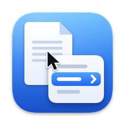
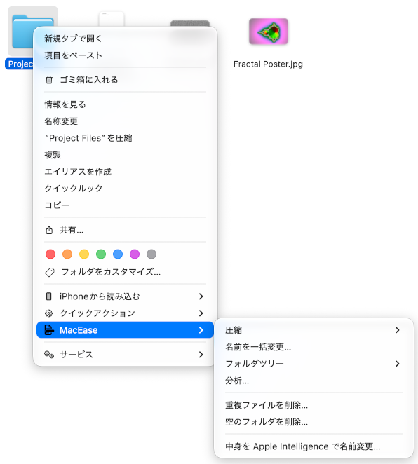
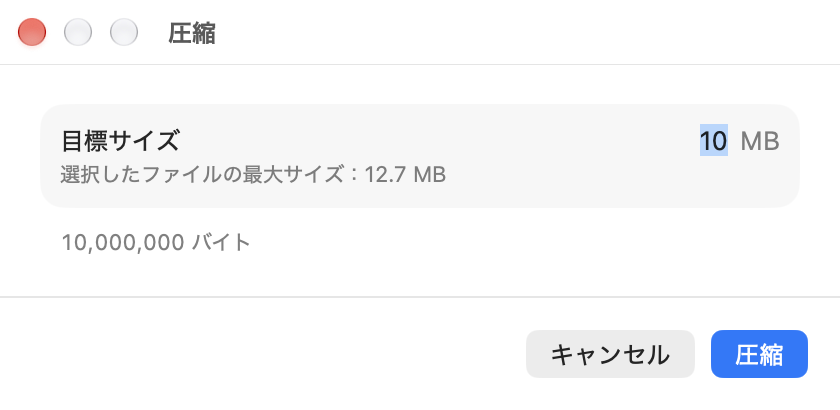
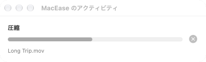
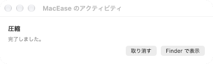
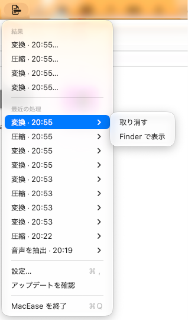
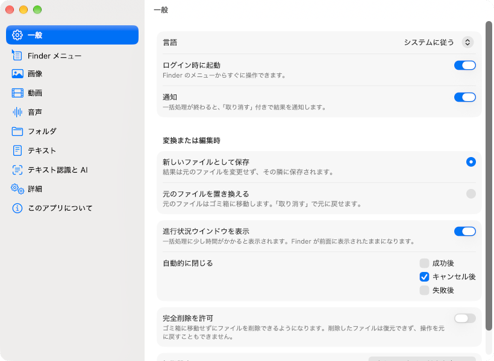
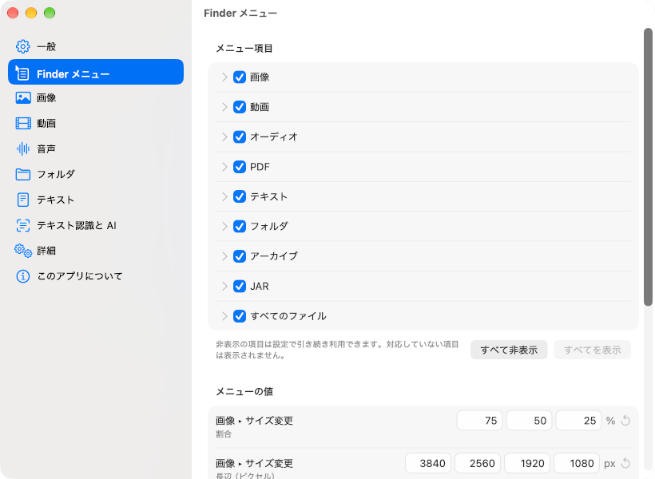

<div align="center">



# MacEase（マッキーズ）

**[English](README.md) | 日本語**

**右クリックするだけ。**

Finder の右クリックメニューから、ファイルやフォルダをそのまま変換・圧縮・編集できます。ほかのアプリを開く必要はありません。

</div>

---

## インストール

1. [公式ダウンロードページ](https://macease-site.pages.dev/ja/#download) から `MacEase-<version>.dmg` をダウンロードし、公開されている SHA-256 チェックサムと一致するか確認します。
2. DMG を開き、**MacEase** を **アプリケーション** にドラッグします。
3. MacEase を開きます。Apple の公証を受けていないため、初回は macOS に起動をブロックされます。
4. **システム設定 > プライバシーとセキュリティ** を開き、下までスクロールして MacEase の横にある **このまま開く** をクリックし、確認します。
   または、ターミナルで次を実行します。
   ```sh
   xattr -dr com.apple.quarantine /Applications/MacEase.app
   ```
5. ようこそウインドウで Finder 拡張機能を有効にします。完了通知が必要なら通知を許可し、**完了** をクリックします。

リリースビルドは自己署名証明書で署名しており、Apple の公証は受けていません。[ソースからビルド](#ソースからビルドする) することもできます。

セットアップ後は、Finder でファイルやフォルダを選んで右クリックし、**MacEase** を選びます。**設定** はメニューバーの MacEase アイコンから開きます。MacEase を再度開くと、セットアップが完了するまではようこそウインドウ、その後は設定が開きます。

**設定 > フォルダアクセス** では標準フォルダと追加したフォルダを確認できます。ここや初回のようこそ画面から **フォルダを追加…** で登録し、アクセス確認やFinderでの表示ができます。登録とmacOSの権限は別で、一覧から削除してもアクセス権限は取り消されません。iCloud管理下でMacEaseメニューが表示されない場合は、Finderの **サービス > MacEaseで操作…** を使えます。右クリックメニューに直接表示される場合もあります。macOSのアクセス要求が待機したままの場合は、**フォルダを追加…** で対象を選び、MacEaseを再起動して再試行してください。この手順にフルディスクアクセスは不要です。

---

## 機能

**変換・編集は初期設定で元を保持します。HatchZip 展開は元のアーカイブを消費します。**

初期設定では、変換や編集の結果を新しいファイルとして元のファイルの隣に保存します。名前が重複する場合は番号を付け、上書きしません。書き出しや通常の抽出では元のファイルを保持します。**設定 > 一般** で元のファイルを置き換えるように変更することもでき、その場合は出力を検証してから元のファイルをゴミ箱に移します。「取り消す」は作成した出力をゴミ箱に移すか、置き換えた元のファイルを戻します。変更されたファイルや、ゴミ箱から失われた元のファイルはスキップする場合があります。それ以外の完全削除は初期設定でオフになっており、確認が必要で、取り消せません。

**HatchZip で展開は例外です。** 確認なしで開始し、検証済みの出力を永続化するにつれて元のアーカイブの領域を解放します。元のアーカイブは保持せず、取り消せません。

ファイルはいくつでもまとめて選べます。1 種類のファイルだけを選ぶと操作が直接表示され、複数の種類を選ぶと種類と件数でグループ化されます。プリセットや形式を選ぶとすぐに実行します。**…** で終わる項目は、入力、確認、レビューのためのウインドウを開きます。画像・動画のメニューは **編集**、**変換**、**圧縮**、**解像度** の順で始まります。

### 画像

| 操作 | 内容 |
| --- | --- |
| **写真を編集…** | 複数写真を一覧で編集。選択した写真や全写真へ調整を適用し、その後は個別に修正 |
| **変換** | PNG、JPEG、HEIC、WebP、AVIF、JPEG XL、GIF、TIFF、BMP、TGA、ICO、ICNS、SVG、PDF。対応する HDR 画像は **SDR** にも変換 |
| **圧縮** | プラットフォーム別プリセット、画質の段階、または **カスタムサイズ…** の目標サイズ |
| **解像度** | 割合や長辺のピクセル数で縮小。720・480・360pxや**カスタムサイズ…** を指定でき、低解像度プリセットでは拡大しません |
| **写真を拡大…** | 同梱 Swin2SR で 2 倍に拡大。1 MP 以下の不透明な 8-bit SDR 静止画1枚から、新しい PNG を保存 |
| **SVGにトレース…** | 静止 PNG と編集可能な SVG パスを比較。1〜8 色と 3 段階の細部設定を選び、新規ファイルに保存 |
| **回転** | 90° 単位の回転と、編集できる追加の角度。左右・上下の **反転** もここにあります |
| **背景** | 背景を削除するか、グリーン・ブルー・任意の色、またはぼかしに置き換え |
| **メタデータを削除** | すべて、位置情報のみ、または設定で選んだ項目を削除 |
| **テキスト認識** | 画像内の文字を読み取り、コピー、`.txt` として保存、または表示 |
| **PDF を作成** | 選んだ画像を 1 つの PDF にまとめる。複数のときはページ順を調整するウインドウを表示 |
| **アイコンを作成** | macOS の `.icns`、Windows の `.ico`、iOS の AppIcon セットを書き出し |
| **余白を切り取る** | 均一な余白を取り除く |
| **Base64 としてコピー** | 画像を `data:` URI としてコピー（初期設定では非表示） |

TGA への変換は、ImageIO が読み込みと書き込みに対応する環境で表示されます。PSD は保存済みの合成画像から PNG、JPEG、TIFF を書き出し、レイヤーを持つ元のファイルは保持します。読み込みに対応するカメラ RAW も元のファイルを保持します。SVG はパスのトレースか PNG の埋め込みを選べます。 **SVGにトレース…** は静止 PNG 1 枚を比較表示し、編集可能なパスを新しい SVG に保存します。ロゴや単色の図形に適しています。写真の忠実な再現、文字の再編集、グラデーションの復元は対象外です。保存前に表示されるメタデータ・透明度・HDR の警告を確認してください。

写真・動画エディタは一般的な編集アプリと同じダークの作業画面です。ツールバー中央で道具を切り替え、右側に比較・取り消し／やり直し・キャンセル・保存を置きます。動画はプレビュー下の再生バーで操作し、調整は操作欄で「ライト」「カラー」「細部」に分けて表示します。
切り取り枠の辺・四隅をドラッグするか、選択範囲をパーセントで入力できます。
自由・元の比率・1:1・4:3・3:2・4:5・16:9に対応。編集前との比較、項目別リセット、
セッション内の取り消し／やり直しも使えます。写真にはブラックポイント・シャープネス・
ノイズ軽減・ビネット・自動補正も用意しています。スタイルは独自プリセットで、
Appleの「フォトグラフスタイル」との互換をうたうものではありません。
複数写真では一覧から切り替え、選択した写真または全写真へ調整を適用できます。
適用後も個別に変更でき、自動補正は写真ごとに解析します。元を保護する保存方針も写真ごとに維持します。
写真の調整中は操作用プレビューを使い、その後に精細な描画を行います。
動画はプレーヤーの表示面を維持してフレームを準備します。ヒストグラム、
キーフレームモードの操作、スライダーの目盛り行はありません。
HDR素材に色調整を加えると **SDR・新しいファイルとして保存** と表示し、必ず元を残します。
アニメーションと複数ページ画像は写真エディタの対象外です。RAWは現像結果を別形式に保存し、元を残します。

### 動画

| 操作 | 内容 |
| --- | --- |
| **動画を編集…** | 複数動画を結合。区間の分割・削除・複製・並べ替え、区間ごとの調整と全体の切り取り・回転・解像度を変更 |
| **変換** | MP4、MOV、M4V、MKV、WebM、AVI、FLV。GIF、アニメーション WebP、APNG。対応する HDR 動画は **SDR** にも変換 |
| **圧縮** | Discord、X、Instagram リール、LINE、メールのプリセット、固定の目標サイズ、画質の段階、または **カスタムサイズ…** |
| **解像度** | 割合や短辺2160p・1080p・720p・480p・360pで縮小。**カスタムサイズ…** では指定した枠内に収めます |
| **再生速度** | 0.5・0.75・1.25・1.5・2・4倍と、0.5〜4倍の任意値を入力できる**カスタム速度…**。音程を維持し、複数動画にも適用できます |
| **サムネイル** | 最初、中央、または選んだフレームを画像として保存 |
| **字幕** | SRT、WebVTT、プレーンテキストに文字起こし、または翻訳した SRT を書き出し |
| **回転** | 90° 単位の回転と、編集できる追加の角度。左右・上下の **反転** もここにあります |
| **音声を抽出** | 原音を再圧縮せずに抽出、または M4A（AAC または ALAC）、MP3、AAC、WAV、AIFF、FLAC、Ogg Vorbis、Opus に明示的に変換 |
| **フレームレート** | フレームレートを変更 |
| **音声を削除** | 音声トラックを取り除く |
| **背景** | 背景を透明・単色・ぼかしにした動画を書き出し |

1 本または複数の動画を区間の列として編集します。**動画を追加…** から素材を追加できます。再生位置で **Command-B** を押すと分割し、選択した区間を **Backspace** で削除すると隙間を詰めます。複製やドラッグによる並べ替えにも対応し、画面上のボタンやタイムラインの右クリックメニューからも操作できます。各操作・ドラッグはセッション内で取り消し／やり直しが可能です。テキスト欄にフォーカスがあるときは文字入力を優先します。速度・音量・色・スタイルは選択区間、切り取り・回転・解像度は出力全体に適用します。結合動画は常に新しいMP4（H.264・SDR・不透明）に保存します。最初の動画から初期の出力サイズとフレームレートを設定し、異なる縦横比は黒い余白付きで全体を収めます。無音素材の区間には無音を挿入します。保存前にHDR・透明度・メタデータの変更表示を確認してください。複数トラックとトランジションは対象外です。

動画・音声のトリミングは、黄色い範囲の両端をドラッグして調整します。⌘＋ホイール、トラックパッドのピンチ、倍率スライダー、⌘＋／−で拡大し、**全体表示**で戻せます。ピンクの追従線は無音のプレビュー、クリックで固定する白い線は再生位置です。端は再生位置と区間境界の8ポイント以内で吸着し、Optionを押すと一時解除できます。**I**・**O** キー、または区間メニュー（動画）や開始・終了の横のボタン（音声）で再生位置に端を合わせられます。音声のトリミングでは `1:05.250` や秒数で時刻を入力できます。音声のトリミングと動画の区間には **フェードイン**・**フェードアウト** を設定できます。動画クリップのサムネイルの下には音声の波形を表示します。再生バーでループ再生を切り替え、**J**・**K**・**L** キーで逆再生・停止・再生ができます（もう一度押すと 2×・4×・8×）。1回のドラッグを1回で取り消せます。

**元の音声をそのまま抽出**は、ビットレート設定を使わず、対応する音声を再圧縮・音量変更・正規化なしでコピーします。形式や再生タイミングを保てない入力は理由を表示して終了します。**MP3（非可逆変換）**を含むMP3出力には同梱のLAMEを使用します。MP3への変換では音質が変化します。未対応の音声タグを含む場合は置き換えを拒否し、新規ファイルでは元を保持して失われる情報を通知します。

### 音声

| 操作 | 内容 |
| --- | --- |
| **変換** | MP3、M4A（AAC または ALAC）、コンテナなしの AAC、WAV、AIFF、FLAC、Ogg Vorbis、Opus、CAF（PCM または ALAC） |
| **字幕** | SRT、WebVTT、プレーンテキストに文字起こし、または翻訳した SRT を書き出し |
| **圧縮** | ビットレートのプリセット、または **カスタムサイズ…** の目標サイズ |
| **ラウドネスを揃える** | 目標のラウドネスに合わせる |
| **トリミング…** | 指定した範囲だけを残す |
| **音声を補正…** | ローカルの音声ノイズ低減（16 kHz モノラル、最大10分）、またはボーカルと伴奏の分離（44.1 kHz ステレオ WAV 2本、最大5分） |

字幕には、Apple のオンデバイスの Speech・Translation フレームワークを使います。

### PDF

| 操作 | 内容 |
| --- | --- |
| **ページを編集…** | 単一PDFのページを選択・プレビューし、並べ替え・削除・取り消し／やり直し |
| **結合** | 2 つ以上の PDF を、選んだ順序で 1 つにまとめる |
| **画像として書き出す** | 各ページを PNG・JPEG としてフォルダ内や PDF の隣に保存するか、1 つの複数ページ TIFF に書き出し |
| **テキストとして書き出す** | テキストを保存。スキャンされた PDF には OCR を使用 |
| **圧縮** | PDF を小さくする |
| **回転** | すべてのページを回転 |
| **ページを抽出…** | 選んだページを新しい PDF として保存 |
| **ページごとに分割** | 1 ページずつ別の PDF として保存 |

PDFのページ編集は保存済みの出力設定に従います。残すページの注釈・フォーム値・アウトライン・内部リンクを検証してから保存し、削除ページへの参照は取り除きます。暗号化や権限制限のある文書では編集を拒否する場合があります。

### 文書とテキスト

| 操作 | 内容 |
| --- | --- |
| **変換** | リッチテキスト文書の書き出し、HTML・Markdown の描画、構造化テキストや字幕ファイルの変換（[変換できる形式](#変換できる形式) を参照） |
| **文字コード** | UTF-8、BOM 付き UTF-8、UTF-16、Shift_JIS に変更 |
| **改行コード** | LF または CRLF に統一 |
| **整形 / 1 行に圧縮 / キーを並べ替え** | JSON を整形。並べ替えでは比較方法、昇順・降順、優先するキー、単純な値の配列を並べ替えるかを指定可能 |

### フォルダ



| 操作 | 内容 |
| --- | --- |
| **整理…** | 内容に基づく分類を確認して直下のファイルを移動。必要なら自動整理を有効化 |
| **圧縮** | フォルダを ZIP、7z、TAR、tar.gz にまとめる |
| **名前を一括変更…** | プレビューを見ながら中身の名前を変更 |
| **フォルダツリー** | フォルダ構成をコピー、またはファイルとして保存 |
| **分析…** | 選んだフォルダの容量をまとめて分析し、CSV、JSON、HTML、プレーンテキスト、Markdown で書き出し |
| **重複ファイルを削除…** | 検証済みの重複ファイルを見つけ、余分なコピーをゴミ箱に移す |
| **空のフォルダを削除…** | 空のフォルダを見つけ、確認後にゴミ箱に移す |

重複ファイルは、初期設定では残すコピーを毎回確認します。更新日時が最も古いコピーか新しいコピーを残し、残りを自動でゴミ箱に移す設定もあります。サイズ、空ファイル、名前、更新日時で候補を絞れます。コピーはバイト単位で比較し、少なくとも 1 つを保持します。フォルダ名、ファイル名、拡張子の除外ルールを、すべてのフォルダ走査または個別の機能に適用できます。

### 自動整理

Finderまたは **設定 > 自動整理** から始めます。分類先フォルダ・指示・変更予定を確認して方針を承認します。既存フォルダは組み替えず、移動先は選択したルートと同じボリューム内に限定します。意味のある名前は維持し、カメラ・スキャンなどの自動生成名だけを変更候補にします。Apple Intelligenceは端末内で実行します。読み取れない・判断できない・AIを利用できないファイルは理由付きで残し、外部AIには送信しません。

監視はフォルダごとに明示的に有効化し、フォルダアクセスの登録とは別に管理します。既定で2分待ち、書き込みが止まってから処理します。個別の一時停止が可能です。**最近の整理** では移動前後のパス・旧名検索・分類修正・まとめて取り消しを利用できます。保存した修正は次回の分類に反映します。取り消しでは変更済みファイルや名前の競合を上書きせず、その処理が作った空のフォルダだけを削除します。戻したファイルは直後に再整理しません。

### 用途別の仕上げレシピ

画像・動画・PDFを選択し、**レシピで仕上げ** から実行します。同梱の **Web掲載用** と **提出用** は **設定 > 仕上げレシピ** で編集・複製・削除できます。種類別に形式・サイズ・画質・ファイル名の接尾辞と複数の出力版を設定し、動画サムネイルやPDFのページ画像・テキストも含められます。未対応の入力は実行前に表示します。

開始時に設定を固定し、各出力版を元ファイルから作成します。必須の出力をすべて検証してから、名前付きフォルダまたはZIPとしてまとめて保存します。原本は保持し、完成品は1回で取り消せます。入力が複数フォルダにまたがる場合は出力先を選びます。合計容量の上限はフォルダ内の出力ファイルの合計、または完成ZIPの実容量に適用します。回数を制限した再調整でも達成できない場合は、未完成品を公開せず失敗理由を表示します。

### アーカイブとその他のファイル

| 操作 | 内容 |
| --- | --- |
| **HatchZip で展開** | 対応するローカルの ZIP・7z・TAR・tar.gz/tgz と認識可能な番号付き分割アーカイブを、元を消費しながら展開。確認なしで開始し、取り消せません |
| **展開** | RAR を新しいフォルダに展開し、元を保持 |
| **内容を見る…** | ZIP 内の階層を検索し、選択したファイルをプレビュー。全体を展開せずに、必要なファイルやフォルダだけを保存 |
| **逆コンパイル** | 同梱の CFR とインストール済みの Java ランタイムで、JAR を Java ソースに変換 |
| **チェックサム** | 任意のファイルの SHA-256、MD5、SHA-1、SHA-512 を計算 |
| **QR コードで共有…** | 明示的に開始する一時的なプライベート LAN の HTTP 共有。通常ファイル1〜20個 |
| **関連ファイルを探す…** | 選択フォルダ内で内容一致と見た目の似た画像を読み取り専用で検索 |
| **暗号化または復号…** | 標準のパスフレーズ形式の `.age` を新規作成または復号し、元を保持 |
| **出典を確認…** | 記録されたリンクと SHA-256 を表示。初期設定では非表示で、設定の Finder メニューから有効化 |


HatchZip のコアは v0.1.10 で、ドットだけのパス、ハードリンク、展開後のディスク上の出力検証を修正しています。HatchZip は RAR と tar.xz に対応しません。

**HatchZip は元のアーカイブを保持しません。** 必要な場合は事前に別のバックアップを用意してください。分割形式は `.zip.NNN`、`.7z.NNN`、`.tar.gz.NNN` に対応し、数字だけの拡張子ではアーカイブと判定しません。変更前にアーカイブ全体、分割ファイル、パス、展開上限、空き容量を検証します。未対応のクラウド／File Provider・ネットワーク上の場所、ハードリンクされた入力、信頼できない復旧記録は破壊的処理の前に拒否します。既存の出力は上書きせず、通常展開への自動切り替えも行いません。

一時停止しても展開済みファイルと復旧状態を保持し、アプリの再起動後もアクティビティの **再開** から続行できます。通常の履歴を消去しても未完了の HatchZip 復旧セッションは削除しません。完了した HatchZip 展開は取り消せません。元と出力は同じボリュームを使い、スナップショットや領域解放への対応状況によって、実際に空く容量が制限される場合があります。通常の展開は RAR のみです。macOS が対応する gzip・bzip2・xz ファイルには展開メニューを表示しません。ZIP の内容閲覧は独立した機能で、元のアーカイブを保持します。

ZIP 閲覧は最大100,000項目、名前などのメタデータ32 MiB、256階層に対応します。プレビューの展開上限は1ファイル256 MiBです。画像・PDF・音声・動画と読み取り専用テキストを表示し、HTMLやスクリプトは実行しません。閉じると一時プレビューを削除します。明示的に保存したファイルは残り、取り消しにも対応します。

### メディアのダウンロード

Finder のフォルダの空白部分、またはフォルダ1個を右クリックして **メディアをダウンロード…** を選ぶと、そのフォルダを保存先にします。公開された HTTP(S) URL を1行に1つ貼り付け、Return キーまたは **解析** でタイトル・長さ・サイズを確認します。**動画**・**音声のみ**・**画像** を選び、動画と音声では形式も選んで、もう一度 Return キーまたは **ダウンロード** を押します。ブラウザからリンクをウインドウにドロップすることもできます。クリップボードにリンクがあるときは **クリップボードのリンクを貼り付け** を表示します。押すまで macOS はリンクがあることだけを伝え、内容は読み取りません。結果には各動画のサムネイルを表示します。プレイリストは未選択で開くため、対象を選んでからダウンロードします。

既定は最高画質・元の形式の動画です。MP4・MKV・WebM、または音声の元の形式・M4A・MP3・WAV・FLAC を選べます。解像度は実際の映像ストリームから選び、縦動画も幅×高さで表示します。複数選択では共通の解像度を表示します。取得元が1種類しか提供していない場合、別の元解像度は選べません。適合する映像・音声は再圧縮せずコピーし、コーデックが適合しない形式では再エンコードが必要になります。字幕は既定でオフです。言語と通常字幕／自動生成字幕を選び、SRT・VTT を動画の横に保存できます。

同時に2件を取得します。アクティビティから中止、失敗分だけの再試行、Finder で表示、取り消しができます。成功・キャンセルした項目は再試行に含みません。ダウンロードでは必ず新規ファイルを作り、同名なら連番を付けます。失敗・中断した未完成ファイルは保存先に残しません。動画断片が欠けた場合は失敗として扱います。H.264末尾の空パケットは、有効な映像・音声パケットと時刻がすべて一致するときだけ除去し、それ以外の破損は拒否します。

YouTube・TikTok など、同梱の yt-dlp が扱える公開サイトが対象です。提供元の変更で利用できなくなる場合があります。Cookie・ログイン連携・DRM 解除・配信中ライブの録画には対応しません。公開済みのライブアーカイブは通常の動画として取得できます。

ローカルファイルは Mac 上で処理します。ダウンロードの解析・取得では指定したサイトと配信元に、更新確認では GitHub に通信します。更新ボタンはアプリの言語に応じた公式ダウンロードページを開きます。これらの機能でローカルファイルをアップロードすることはありません。取得用ツールはアプリに同梱し、MacEase と一緒に更新します。利用者が Python や Homebrew を導入する必要はありません。

**画像** は gallery-dl を使い、画像1〜512枚の直接の公開投稿・アルバム URL に対応します。プロフィール、コレクション、子ギャラリーの再帰取得には対応しません。画像を検証してから新しいフォルダを保存し、ページ URL・取得日時・ファイル名を `MacEase Source.json` に記録します。動画と音声は WhereFroms 拡張属性にページ URL を記録します。**出典を確認…** はこのローカル記録と SHA-256 を表示します。リンクは編集可能なメタデータで、著作者や真正性の証明ではありません。Web の自動調査は行いません。

### ローカル共有と暗号化

**QR コードで共有…** でプライベートな Wi-Fi または Ethernet を選び、**共有を開始** を押します。同じ信頼できるネットワーク上の Android などの端末から QR コードを読み取るか、表示されたリンクをブラウザで開きます。通常ファイル最大20個を、ランダムな32バイトのトークンを含む URL で共有します。有効期間中はリンクを持つ人が取得できます。15分で期限切れとなり、**共有を停止** またはウインドウを閉じると無効になります。**HTTP は暗号化されません。** 信頼できるプライベートネットワークを使ってください。クラウドへのアップロードやインターネットへのポート公開は行いません。処理が続くアクティビティとは異なり、共有ウインドウは開いておく必要があります。

**暗号化または復号…** は age v1.3.2 と標準 age scrypt 形式を使います。新しいパスワードは12文字以上と確認入力が必要です。忘れたパスワードは復旧できません。パスフレーズはその処理でだけ保持し、別プロセスの標準入力に渡します。引数、環境変数、ログ、履歴には残しません。暗号化は復号した内容を検証し、復号は認証を完了してから新しいファイルを保存します。どちらも元を保持します。詳しくは[暗号化の仕様](docs/encryption.md)を参照してください。

### ローカルの補正と関連ファイル

**写真を拡大…** は同梱 Swin2SR を Core ML で実行します。1,000,000画素以下の不透明な 8-bit SDR 静止画1枚が対象で、HDR・透過・アニメーション・複数ページは拒否します。入力を自動縮小せず、2倍の新しい PNG を保存します。24 GB の M5 では1 MP の処理に134.42秒、RSS は1.33 GB でした。ほかの Mac での速度や品質を保証する値ではなく、補正によって本物の細部を証明することもできません。詳しくは[拡大モデル](docs/upscaler.md)を参照してください。

**音声を補正…** は同梱 GTCRN または Spleeter を CPU 上で一定長に区切って実行します。音声ノイズ低減は最大10分で、16 kHz モノラル WAV を出力し、ステレオはモノラルに混合します。分離は最大5分で、ボーカルと伴奏の両方を44.1 kHz ステレオ WAV に保存します。入力はモノラルまたはステレオです。元を保持し、タグはコピーしません。出力は32-bit float WAV ですが、ネイティブツール内の16-bit 中間出力で失われた精度は戻りません。実行時のモデル取得や Apple Intelligence は不要で、同梱リソースが不足していれば明示的に失敗します。[音声モデルと正確な来歴](docs/ai-audio.md)を参照してください。

**関連ファイルを探す…** は通常ファイル1個から開始し、初期範囲はそのファイルのフォルダです。**フォルダを選択…** で範囲を変更できます。内容一致はサイズ・SHA-256・バイト単位の比較で検証します。似た画像はローカルの Vision 特徴量の距離0.5以下を使い、重複とは区別して表示します。結果は Finder で表示でき、検索は移動・削除を行いません。シンボリックリンクとパッケージ内部は検索しません。

### Apple Intelligence

| 操作 | 内容 |
| --- | --- |
| **Apple Intelligence で名前を変更…** | 画像や PDF の内容に基づく名前をプレビューして確定 |
| **中身を Apple Intelligence で名前変更…** | フォルダ直下の画像や PDF に同じ処理を実行 |
| **Apple Intelligence に指示…** | 言葉で指定した依頼を、対応する画像・動画・音声操作の実行計画に変換し、確認してから実行 |

### プリセット

圧縮には、Discord、X、Instagram、LINE、メール、Web 向けの同梱設定があります。**設定 > Finder メニュー** で編集できます。これらはアプリの初期値であり、各サービスの現在のアップロード上限を保証するものではありません。

### パネル、進行状況、取り消し

**カスタムサイズ…** は **解像度** と **圧縮** にだけ表示されます。**反転** は **回転** の中、アニメーションの書き出しは動画の **変換** の中にあります。HDR の変換は **変換 > SDR** です。ほかのウインドウは、必要な入力、削除の確認、結果の表示に使います。PDF の結合と複数画像からの PDF 作成では、ページ順を調整するウインドウが開きます。



**アクティビティ** は開始から2秒後も実行中なら、Finder のフォーカスを奪わず自動表示します。短時間で完了する処理では開きません。この更新時は既存環境でも一度だけ自動表示を有効にし、その後の設定変更は維持します。設定をリセットすると再び有効になります。**停止** で通常の処理をキャンセルし、HatchZip は一時停止できます。ウインドウを閉じても処理は続きます。

完了したファイル数と、現在の工程の進捗を分けて表示します。計測できる工程は受信バイト数、処理した動画・音声の時間、PDF のページ数を使い、候補の探索や総量が分からない処理は工程名と不定のバーを表示します。検証と保存が終わるまで完了にはなりません。

アクティビティには処理段階、経過時間、ファイルごとの結果を表示します。**比較…** では、圧縮・変換に成功した静止画像を原本と左右に並べ、倍率と表示位置を同期できます。**全体を表示**、**100%**、実容量、寸法、減色・縮小の有無を確認できます。置き換えた原本は、記録されたゴミ箱内の場所から読み取ります。変更・削除されたファイルは比較できません。

**失敗した項目を再実行…** は、画像・動画・音声の圧縮と変換、PDF圧縮で失敗した入力だけを、元の設定で再処理します。容量指定では目標値を変更できます。成功・変更不要・キャンセルしたファイルは含みません。入力が変更されている場合は、Finderから新しく操作を実行してください。アクティビティには現在の起動セッションで最大20件の結果を保持します。結果を閉じるかウインドウを閉じると、完了行と対応する通知は消えます。実行中の処理は続き、メニューバーの最近の処理から取り消せます。比較・再実行用の情報は結果を閉じた時点で破棄されます。

カスタム容量は十進単位で、**10 MBは10,000,000 bytes以下**です。画像は形式を保持し、まず元の解像度で試します。PNGの容量を大幅に減らす場合は、色の細部・解像度・処理時間のバランスを取り、減色を繰り返す代わりに、許可されていれば縮小します。減色した候補の品質を確認し、必要な場合はフルカラーの縮小に切り替えます。カスタム容量パネルで **解像度の低下を許可** を確認でき、画像の設定は動画から独立しています。すでに上限以下の入力は変更しません。追加の可逆PNG最適化を省略しても、圧縮の失敗を意味しません。容量上限の達成は、検証済み出力の実容量で判定します。

<br>


初期設定では、問題なく完了した処理は自動で閉じます。アクティビティが表示されている場合、警告、スキップ、失敗した項目は残ります。結果がそこに残らない場合は、通知が有効なら完了通知を表示します。利用可能な場合は **Finder で表示** や **取り消す** を選べます。最近の処理はメニューバーにも表示され、利用できる場合は **取り消す** や **Finder で表示** を選べます。HatchZip 展開には取り消しはありません。更新がある間はメニューバーに印とダウンロード項目を表示し、通知は1日1回行います。



---

## 変換できる形式

| 入力 | 出力 |
| --- | --- |
| **PNG、JPEG、HEIC、WebP、AVIF、JPEG XL、GIF、TIFF、BMP、TGA、ICO、ICNS、SVG** | この行のほかの形式、または PDF |
| **PSD** | PNG、JPEG、TIFF |
| **カメラ RAW** | 1 行目の画像形式、または PDF |
| **アニメーション GIF、APNG、アニメーション WebP** | GIF、APNG、アニメーション WebP（すべてのフレームを保持） |
| **HDR の JPEG、HEIC、AVIF、JPEG XL、PNG**（単一画像） | SDR |
| 画像 → **PDF を作成** / **アイコンを作成** | PDF / ICNS、ICO、AppIcon セット |
| **MP4、MOV、M4V、MKV、WebM、AVI、FLV** | この行のほかの形式 |
| 動画 → **変換** | GIF、アニメーション WebP、APNG |
| 動画 → **音声を抽出** | M4A（AAC または ALAC）、MP3、AAC、WAV、AIFF、FLAC、Ogg Vorbis、Opus |
| **HDR の MP4、MOV、M4V**（対応条件を満たす Dolby Vision 8.4 のベースレイヤーを含む） | SDR |
| **MP3、M4A（AAC または ALAC）、コンテナなしの AAC、WAV、AIFF、FLAC、Ogg Vorbis、Opus、CAF（PCM または ALAC）** | この行の形式 |
| 音声・動画 → **字幕** | SRT、WebVTT、プレーンテキスト、翻訳した SRT |
| **PDF** | PNG・JPEG のページ画像、複数ページ TIFF、TXT |
| **DOCX、ODT、RTF、RTFD** | PDF、TXT |
| **HTML** | ソースの TXT、描画結果の TXT、PDF |
| **Markdown** | ソースの TXT、HTML、PDF |
| **CSV** | TXT、JSON、XML、HTML、Markdown |
| **JSON** | TXT、CSV、XML、XML またはバイナリの plist、YAML、TOML |
| **XML** | TXT、JSON |
| **INI、CFG、CONF** | TXT、JSON、XML |
| **YAML、TOML** | TXT、JSON |
| **XML またはバイナリの plist** | JSON |
| **SRT、WebVTT** | ソースの TXT、もう一方の字幕形式 |
| **その他の認識可能なテキストファイル** | TXT。ただし、すでに TXT に分類されるファイルを除く |
| **フォルダ** | ZIP、7z、TAR、tar.gz |
| **ローカルの ZIP、7z、TAR、tar.gz/tgz と認識可能な番号付き分割アーカイブ** | HatchZip 展開。元を消費し、取り消し不可 |
| **RAR** | 元を保持して展開したフォルダ |
| **JAR** | 逆コンパイルした Java ソースのフォルダ |
| 文字コード | UTF-8、BOM 付き UTF-8、UTF-16、Shift_JIS |
| 改行コード | LF、CRLF |

AIFF-C の読み込みはコーデックに依存します。コンテナに対応していても、その中のすべてのコーデックを扱えるわけではありません。SDR から HDR への変換、WMA、AV1 動画のエンコード、RAR の作成は未実装です。画像・動画・音声の操作は選択したファイルを対象とし、フォルダ内のメディアを走査しません。

<details>
<summary><b>制限と保護のしくみ</b></summary>

文書の書き出しは基本的なリッチテキストの再配置を行うため、Office 文書のレイアウトが変わる場合があります。HTML の描画ではスクリプトと外部リソースを遮断し、PDF は連続した 1 ページに書き出します。Markdown は生の HTML と安全でないリンクを省きます。構造化テキストの変換ではコメントや書式が失われる場合があり、対応しない値の変換はエラーになります。JSON から CSV への変換には、入れ子のないオブジェクトの配列が必要です。字幕変換はプレーンテキストの範囲に対応し、未対応の装飾やメタデータはエラーになります。これらの書き出しでは、どちらの出力モードでも元のファイルを保持します。

画像変換では、アニメーションのフレームや TIFF のページを失う変換を拒否します。新しい画像ファイルで透明度や HDR を保持できない場合、対応する処理では指定した背景色で合成するか SDR にトーンマッピングし、警告を表示します。画像編集や形式変換で置き換える場合は、意図しない透明度や HDR の喪失を拒否します。明示的な **変換 > SDR** は選んだ出力モードに従い、内容を確認して SDR の入力はスキップします。動画の編集は、どちらの出力モードでも、複数の映像・音声トラックや保持できないストリームがある入力を拒否します。明示的な書き出しは元のファイルを保持し、省略するストリームを知らせます。

</details>

[docs/SPEC.md](docs/SPEC.md) は目標とする製品の仕様を記載しています。すべての対応 macOS バージョンで検証済みではない受け入れ基準も含みます。

---

## 設定

メニューバーのアイコンから **設定** を開きます。変更はすぐに反映されます。



- **一般** – 言語、ログイン時に起動、通知、**新しいファイルとして保存** か **元のファイルを置き換える** か、アクティビティウインドウの表示と自動で閉じる条件、完全削除の許可、ようこそウインドウ。
- **Finder メニュー** – 種類、操作、プリセット、形式ごとの表示と非表示、リサイズや圧縮の数値、追加の回転角度、プラットフォーム別プリセットの編集。一部の形式やユーティリティは初期設定で非表示です。
- **画像**、**動画**、**音声**、**フォルダ**、**テキスト**、**テキスト認識と AI** – 品質、背景、アニメーション、音声、字幕、OCR、PDF、フォルダ、テキストの既定値。重複ファイルの一致条件や除外ルールもここにあります。
- **詳細** – **すべての設定をリセット…** は履歴と編集済みのプラットフォーム別プリセットを保持します。
- **このアプリについて** – バージョンと **サードパーティ製ソフトウェアのライセンス表記**。



---

## 動作環境

| 必要なもの | 詳細 |
| --- | --- |
| **Mac** | Apple シリコン搭載の Mac、macOS 26 以降 |
| **Finder 拡張機能** | 右クリックメニューに必要。有効にしてください |
| **Apple Intelligence** | Apple Intelligence による名前変更と指示機能にのみ必要。ローカルの画像拡大と音声補正には不要。有効化とオンデバイスモデルの利用準備が必要です。ほかの操作には必要ありません |
| **Speech・Translation のデータ** | 文字起こしには対応する Speech の言語データ、字幕翻訳には Translation のモデルのインストールが必要です。不足している場合は MacEase が知らせます |
| **Java ランタイム** | JAR のデコンパイルにのみ必要。macOS が検出できる場所にインストールしてください |

処理は Mac 上で行います。更新の確認には GitHub に接続します。Apple の一部の機能には、言語データやモデルのインストールが必要です。

VoiceOverはサポート対象外です。

---

## よくある質問

<details>
<summary><b>Finder のメニューに MacEase が表示されない</b></summary>

ようこそウインドウか **システム設定 > 一般 > ログイン項目と機能拡張** から Finder 拡張機能を有効にしてください。セットアップ後に拡張機能がオフになっている間は、メニューバーのアイコンに注意を促すバッジが表示されます。選んだファイルに合う項目だけが表示され、一部の形式やユーティリティは初期設定で非表示です。**設定 > Finder メニュー** で表示できます。

</details>

<details>
<summary><b>新しいファイルはどこに保存されますか？</b></summary>

元のファイルと同じフォルダ、元のファイルの隣に保存します。名前が重複する場合は上書きせず番号を付けます。**元のファイルを置き換える** を選んでいる場合は、結果を検証してから元のファイルをゴミ箱に移します。**HatchZip で展開** は確認なしで元のアーカイブを消費し、元を保持しません。

</details>

<details>
<summary><b>操作を取り消せますか？</b></summary>

はい。アクティビティ、完了通知、またはメニューバーの **最近の処理** から **取り消す** を選びます。「取り消す」は作成した出力をゴミ箱に移すか、置き換えた元のファイルを戻します。削除したファイルはゴミ箱に移ります。ただし、完全削除を許可して確認した場合はゴミ箱を経由せず、取り消せません。**HatchZip 展開にも取り消しはなく**、確認なしで開始します。一時停止した HatchZip は再開できますが、元のアーカイブを復元する機能ではありません。

</details>

<details>
<summary><b>初回起動時に macOS にブロックされるのはなぜですか？</b></summary>

リリースビルドは自己署名証明書で署名しており、Apple の公証を受けていないためです。[インストール](#インストール) の手順 3 と 4 に従うか、ソースからビルドしてください。

</details>

<details>
<summary><b>ファイルはアップロードされますか？</b></summary>

処理は Mac 上で行います。ダウンロードは指定サイトに接続します。QR 共有はプライベートネットワーク上で一時リンクを持つ端末に選択ファイルを提供し、HTTP は暗号化されません。更新の確認には GitHub に接続します。また、Speech、Translation、Apple Intelligence の機能に必要なデータを macOS がダウンロードする場合があります。

</details>

---

## ソースからビルドする

必要なものは、Apple シリコン搭載の Mac、macOS 26 以降、Xcode 26 以降、Homebrew、Rust 1.93 以降（Cargo を含む）です。`make bootstrap` は XcodeGen・CMake・Meson・Ninja・pkg-config を導入し、Cargo がなければ Rust も導入します。Go と Python 3.11 がなければ導入し、メディアツールと同梱モデルを含むツールキットもビルドします。ビルドスクリプトは固定したソースとモデルを取得しますが、通常の補正処理では取得しません。既存の Rust が古い場合はビルド前に更新してください。macOS 27 専用の機能をビルドするには Xcode 27 が必要です。

```sh
git clone https://github.com/TKY-27/MacEase.git
cd MacEase
make bootstrap
make build
make test
make test-app
```

パッケージの検証は負荷の競合を避けるため順番に実行します。並行処理のテスト内では、引き続き並行動作を検証します。

初回起動の前に、`build/DerivedData/Build/Products/Debug/MacEase Dev.app` を `~/Applications` または `/Applications` にコピーしてください。このどちらにもない場合、ようこそウインドウを完了できません。Finder 拡張機能は、ようこそウインドウか **システム設定 > 一般 > ログイン項目と機能拡張** から有効にできます。

| 目的 | コマンド |
| --- | --- |
| 独立したダウンロード・メディアツールの再ビルド | `make media-tools` |
| age、音声ランタイム・モデル、Core ML 拡大モデルのビルド | `make toolkit` |
| 固定したビルド専用 Python 環境で拡大モデルだけを再ビルド | `scripts/build-upscaler.sh` |
| 実機でパッケージとアプリの全テスト | `make test-device` |
| Swift の厳格な lint | `make lint` |

拡大モデルの変換環境は `Vendor/build/upscaler-work` に置きます。PyTorch・Transformers とその Python 環境は推論用として配布しません。
詳しくは [CONTRIBUTING.md](CONTRIBUTING.md) を参照してください。

### 仕組み

サンドボックス化された Finder Sync 拡張機能が、メニューバーアプリの書き出したカタログから右クリックメニューを作ります。選択した操作とファイルパスは、トークンで検証する URL スキームでアプリに渡します。アプリは処理を実行し、入力パネル、アクティビティ、設定を表示します。`Packages/MacEaseKit` には `MenuCatalog`、`Engine`、`Formats` があります。

文書、画像、メディア、OCR、音声認識、翻訳には Apple のフレームワークを使います。同梱の Swift パッケージ依存関係には、Markdown 用の **swift-cmark** と、libyaml を含む YAML 用の **Yams** があります。TOML には同梱の **toml++** を、メモリの所有権を管理する C ブリッジ経由で使います。ほかの形式は、libwebp、libavif、libjxl、libvpx、libopus、libarchive などの許諾条件が緩やかなライブラリと、GIF エンコーダ、Matroska・WebM コンテナ、SVG トレースなどの独自実装で扱います。アーカイブを消費する展開には、MIT ライセンスを選択した **hatchzip-core 0.1.10** の固定版を Rust ヘルパー経由で使用し、UnRAR は無効化しています。通常の RAR 展開は libarchive を使います。メディア取得には専用の Python、ソース配布の yt-dlp と独立した gallery-dl、EJS、JavaScript 実行環境を使用します。独立した FFmpeg・ffprobe は取得メディアを補助します。ローカルMP3出力もPCMをFFmpeg/libmp3lameへ逐次渡し、中間音声ファイルを作らず処理します。これらのツールは別ライセンスと対応ソースを維持し、MacEase独自コードはMITのままです。[同梱ツール](docs/media-tools.md)も参照してください。

詳細は [docs/SPEC.md](docs/SPEC.md) と [docs/adr/](docs/adr/) を参照してください。

---

## コントリビュート

Issue や Pull Request を歓迎します。[CONTRIBUTING.md](CONTRIBUTING.md) と [行動規範](CODE_OF_CONDUCT.md) をお読みください。セキュリティ上の問題は、[SECURITY.md](SECURITY.md) に従って非公開で報告してください。

## 謝辞

Windows エクスプローラー向けツール [Flect](https://github.com/Konayukiw/Flect) を、メニューの操作と機能の参考にしています。MacEase は Flect のコードや素材を再利用せず、その設計を macOS 向けに独立して実装しています。

## ライセンス

[MIT](LICENSE)。同梱の依存コンポーネントには、それぞれのライセンスが適用されます。swift-cmark の BSD・MIT のライセンス表記、Yams・libyaml の MIT ライセンス、toml++ と hatchzip-core の MIT ライセンスも含みます。これらのライセンス文は、ネイティブライブラリの表記とともにアプリの `THIRD_PARTY_NOTICES.txt` に同梱します。**設定 > このアプリについて > サードパーティ製ソフトウェアのライセンス表記** から確認できます。

ダウンロード用ツールには、GPL・nonfree 機能を無効にした LGPL の FFmpeg と LAME を含みます。これらは独立した実行ファイルとして、それぞれのライセンスに従います。リリースには対応ソースとビルド手順を添付します。[メディアツールのビルド](docs/media-tools.md)も参照してください。MacEase 本体のソースは MIT のままです。

未改変の独立した gallery-dl 1.32.19 ランタイムは GPL-2.0-only で、独自のライセンスと完全に対応するソースを同梱し、MacEase にリンクしません。Swin2SR は Apache-2.0、GTCRN・Spleeter モデルは MIT です。ネイティブの sherpa-onnx は Apache-2.0、ONNX Runtime は MIT で、サードパーティ表記と Eigen の MPL-2.0 対応ソースを音声ランタイムに同梱します。別プロセスの age ブリッジは BSD-3-Clause の age と許諾条件が緩やかな依存関係を使います。固定バージョン、来歴、配布条件は [ADR 0057](docs/adr/0057-local-toolkit-and-release.md) と各機能文書を参照してください。MacEase のソースは MIT のままです。
