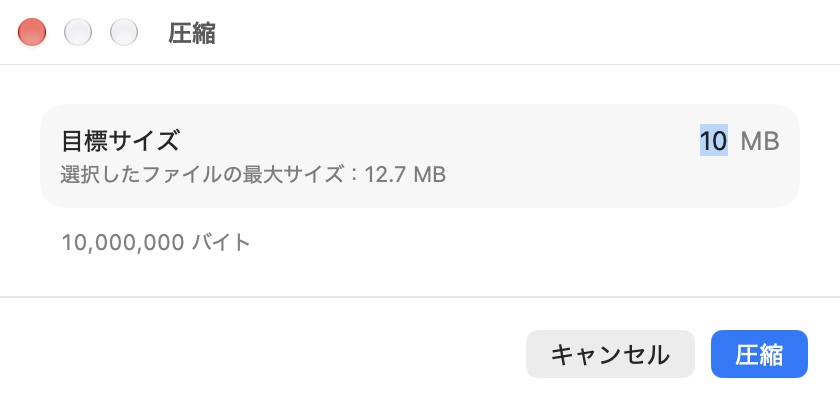
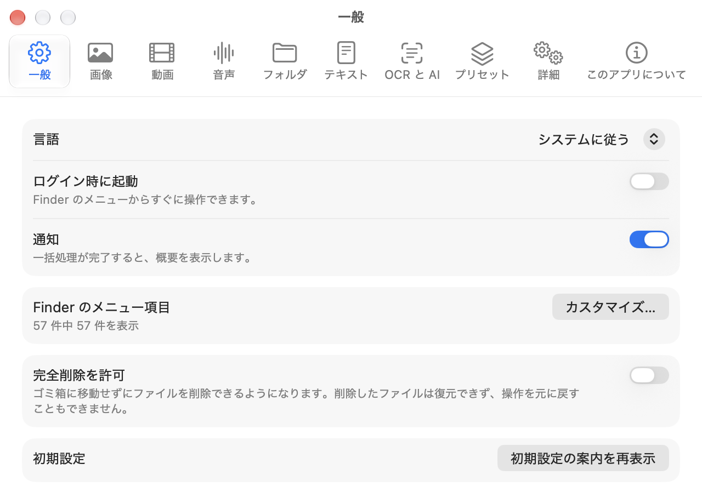

# MacEase(マッキーズ)

**Finderでファイルを右クリックするだけで、変換・圧縮・リサイズなどができます。**

[English](README.md) | 日本語

MacEaseは、Finderの右クリックメニューに項目を1つ追加します。ファイルを選んで右クリックし、やりたいことを選ぶだけで、そのファイル自体が変換されます。アプリのウィンドウを開いたり、変換サイトにアップロードしたり、Discord用に動画を縮めるためだけに編集ソフトを起動したりする必要はありません。

## なぜ作ったか

- iPhoneの写真はHEICで保存され、受け付けないサイトがある
- 画面収録の動画が大きすぎて、DiscordやX、メールで送れない
- 動画をGIFにしたい、画像の背景を透明やグリーンバックにしたい、フォルダが重複ファイルだらけ

macOS標準のクイックアクションでも一部はできますが、対応形式・目標サイズ指定・一括処理には限りがあります。MacEaseはこれらをすべて右クリック1回で行えるようにします。処理はすべてMac上で完結し、MITライセンスの無料オープンソースです。

## 機能

- **画像:** リサイズ、目標サイズへの圧縮、任意角度の回転、反転、余白の自動トリミング、PNG・JPEG・HEIC・WebP・AVIF・JPEG XL・GIF・TIFF・BMP・ICO・ICNS・SVG・PDFの相互変換、OCR、メタデータ削除、背景の透過またはグリーン・ブルー・任意色・ぼかしへの置き換え、アプリアイコン一式の書き出し
- **動画:** リサイズ、トリム、目標サイズへの圧縮、回転、反転、フレームレート変更、音声の削除、MP4・MOV・M4V・MKV・WebM・AVI・FLVの相互変換、GIF・アニメーションWebP・APNG化、音声の抽出、サムネイル書き出し、字幕の生成と翻訳、背景を透過した動画やグリーン・ブルーバック動画の書き出し。置き換え操作は映像・音声がそれぞれ1トラック以下の入力に対応し、派生ファイルの書き出しは各種類の先頭トラックを使います。
- **音声:** MP3・M4A・AAC・WAV・AIFF・FLAC・OGG・Opusの相互変換、圧縮、音量の正規化、トリム
- **フォルダ:** 重複ファイル・空フォルダの削除、ツリー出力、一括リネーム、容量の分析、ZIP・7z・TAR・tar.gzへの圧縮
- **アーカイブ:** ZIP・7z・TAR・gz・bz2・xz・RARの展開
- **PDF:** 結合、分割、ページ抽出、回転、圧縮、画像やテキストへの書き出し
- **テキスト:** 文字コード(UTF-8・UTF-16・Shift_JIS)と改行コードの変更、CSV・JSON・XML・HTML・Markdown・INI・YAML・TOMLの相互変換、MarkdownからHTML・PDFへの書き出し、JSONの整形とキーのソート
- **Apple Intelligence:** やりたいことを言葉で指定したり、中身に応じてファイル名を付けたりできます(対応するMacのみ)
- **プラットフォーム別プリセット:** Discord・X・Instagram・LINE・メール・Web向けにワンクリックで最適化。プリセットは編集できます

元のファイルは安全です。初期設定では、結果を新しいファイルとして保存します。元のファイルを置き換える設定にした場合も、新しいファイルが完全に書き出されて確認できてから置き換え、元のファイルはゴミ箱へ移します。どの処理も、通知・アクティビティウインドウ・メニューバーから元に戻せます。

各操作の詳しい動作は [docs/SPEC.md](docs/SPEC.md)(英語)にまとめています。

## 動作環境

- Appleシリコン搭載のMac
- macOS 26以降
- Apple Intelligenceの機能は、Apple Intelligenceがオンになっている対応Macが必要です
- JARのデコンパイルにはJavaランタイムが必要です

## インストール

1. [Releases](https://github.com/TKY-27/MacEase/releases/latest) から `MacEase-<バージョン>.dmg` をダウンロードし、リリースページのSHA-256チェックサムと一致するか確認します。
2. DMGを開き、**MacEase** を **アプリケーション** にドラッグします。
3. MacEaseを開きます。公証(Notarization)を受けていないため、初回はmacOSに起動をブロックされます。
4. **システム設定 > プライバシーとセキュリティ** を開き、下までスクロールしてMacEaseの横にある **このまま開く** をクリックし、確認します。
   または、ターミナルで次を実行します。
   ```sh
   xattr -dr com.apple.quarantine /Applications/MacEase.app
   ```
5. ようこそウインドウで、Finder拡張機能と通知をオンにします。

MacEaseは独自の証明書で署名していますが、Appleの公証は受けていません。有料の開発者アカウントを持たない個人のオープンソースプロジェクトのためです。気になる場合は、ソースから自分でビルドすることもできます(下記参照)。

## 使い方

1. Finderでファイルやフォルダを1つ以上選び、右クリックして **MacEase** を選びます。選んだファイルの種類に合った操作が表示されます。
2. 操作とプリセットを選びます(例: 動画なら **圧縮 > Discord (20 MB)**)。ほとんどの項目はすぐに実行されます。「…」で終わる項目(**カスタムサイズ…** など)は、先に小さなパネルが開きます。
   複数の入力を選んだ場合、PDF の **結合** と **PDF を作成** では、実行前にページ順を調整するパネルが開きます。
3. 処理に少し時間がかかると、Finderのフォーカスを奪わずにアクティビティウインドウが進行状況を表示し、そこから停止できます。処理が終わると通知が届き、**取り消す** や **Finder で表示** を選べます。問題があった項目やスキップした項目はアクティビティウインドウに残ります。重複ファイル・空のフォルダの検索と分析の進行状況もここに表示されます。

初期設定では、結果を元のファイルの隣に新しいファイルとして保存します。**設定 > 一般** で元のファイルを置き換えるように変更でき、その場合は元のファイルがゴミ箱へ移り、**取り消す** で戻せます。



メニューバーのアイコンから **設定** を開きます。**Finderメニュー** ページでは個々のメニュー項目の表示・非表示、リサイズの割合や圧縮サイズなどのメニューの値、プラットフォーム別プリセットの編集を、ほかのページではファイルの種類ごとの既定値を変更できます。



## ソースからビルドする

必要なもの: Appleシリコン搭載のMac、macOS 26以降、Xcode 26以降(macOS 27の機能にはXcode 27)、Homebrew

```sh
git clone https://github.com/TKY-27/MacEase.git
cd MacEase
make bootstrap
make build
make test
```

初回起動の前に、`build/DerivedData/Build/Products/Debug/MacEase Dev.app` を
`~/Applications` または `/Applications` にコピーしてください。アプリがこのどちらにも
ない場合、ようこそウインドウを完了できません。Finder拡張機能はようこそウインドウ、または
**システム設定 > 一般 > ログイン項目と機能拡張** から有効にできます。

詳しくは [CONTRIBUTING.md](CONTRIBUTING.md)(英語)を参照してください。

## 仕組み

MacEaseは2つの部分でできています。メニューを表示する、サンドボックス化されたFinder Sync拡張機能と、実際の処理を行うメニューバーアプリです。拡張機能は、選ばれた操作と選択中のファイルを、専用のURLスキームでアプリに渡します。中心となる処理は `MacEaseKit` というSwiftパッケージにあります。Appleが提供していない形式は、制限の緩いライセンスのライブラリ(libwebp・libavif・libjxl・libvpx・libopus・libarchiveなど)か、MacEase独自のSwift実装(MP3エンコーダ、GIFエンコーダ、Matroska/WebM、SVGトレースなど)で扱います。

詳細: [docs/SPEC.md](docs/SPEC.md)、[docs/adr/](docs/adr/)

## コントリビュート

IssueやPull Requestを歓迎します。[CONTRIBUTING.md](CONTRIBUTING.md) と [行動規範](CODE_OF_CONDUCT.md) をお読みください。セキュリティ上の問題は、[SECURITY.md](SECURITY.md) に従って非公開で報告してください。

## 謝辞

MacEaseは、Windowsエクスプローラー向けの右クリックツール [Flect](https://github.com/Konayukiw/Flect) に着想を得ています。MacEaseはmacOS向けにゼロから作った独立したプロジェクトです。

## ライセンス

[MIT](LICENSE)。同梱しているサードパーティ製コンポーネントとそのライセンスは、アプリ内の `THIRD_PARTY_NOTICES.txt`(設定 > 情報)に記載しています。
