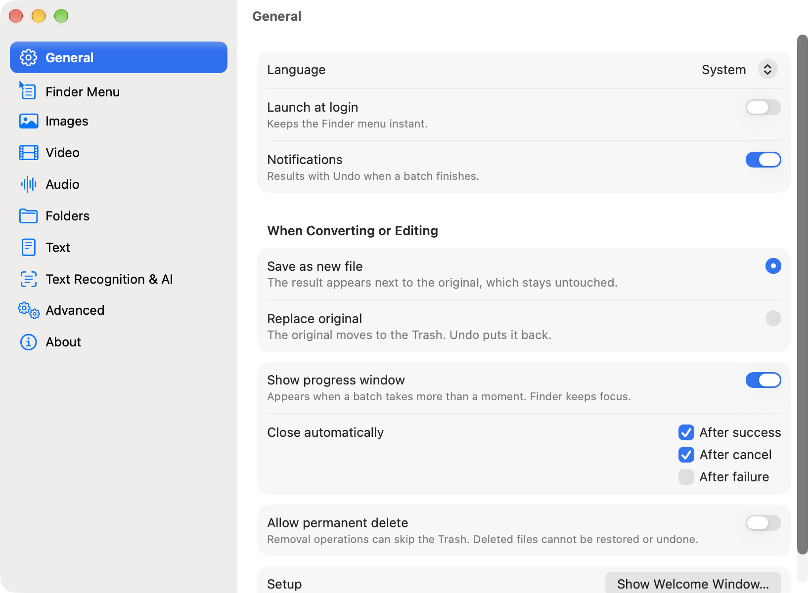

# MacEase

**Right-click any file in Finder to convert, compress, resize and more.**

English | [日本語](README.ja.md)

MacEase adds one menu to Finder's context menu. Select files, right-click, pick
what you want, and the files are transformed in place. No app window to open, no
website to upload to, no video editor just to shrink a clip for Discord.

## Why

- iPhone photos arrive as HEIC and some sites refuse them.
- A screen recording is too large for Discord, X or email.
- A clip should be a GIF, an image needs a transparent or green background, a
  folder is full of duplicates.

macOS covers a few of these with Quick Actions, but formats, size targets and
batch work are limited. MacEase puts all of it one right-click away, runs
entirely on your Mac, and is free and open source under the MIT License.

## Features

- **Images:** resize, compress to a target size, rotate any angle, flip, trim
  borders, convert between PNG, JPEG, HEIC, WebP, AVIF, JPEG XL, GIF, TIFF, BMP,
  ICO, ICNS, SVG and PDF, OCR, strip metadata, remove the background or replace
  it with green, blue, any color or blur, export app icon sets.
- **Videos:** resize, trim, compress to a target size, rotate, flip, change frame
  rate, remove audio, convert between MP4, MOV, M4V, MKV, WebM, AVI and FLV,
  make GIF, animated WebP or APNG, extract audio, export thumbnails, generate and
  translate subtitles, remove the background into transparent video or a green or
  blue screen. Replacement operations require at most one video and one audio
  track; derived exports use the first track of each kind.
- **Audio:** convert between MP3, M4A, AAC, WAV, AIFF, FLAC, OGG and Opus,
  compress, normalize loudness, trim.
- **Folders:** remove duplicates and empty folders, print a tree, batch rename,
  analyze disk usage, compress to ZIP, 7z, TAR or tar.gz.
- **Archives:** extract ZIP, 7z, TAR, gz, bz2, xz and RAR.
- **PDFs:** merge, split, extract pages, rotate, compress, export pages as images
  or text.
- **Text:** change encoding (UTF-8, UTF-16, Shift_JIS) and line endings, convert
  between CSV, JSON, XML, HTML, Markdown, INI, YAML and TOML, render Markdown
  to HTML or PDF, pretty-print and sort JSON.
- **Apple Intelligence:** describe what you want in plain words, or rename files
  by their content, on supported Macs.
- **Platform presets:** one click to fit Discord, X, Instagram, LINE, email or
  the web. Presets are editable.

Your originals are safe: results are saved as new files by default. If you
choose to replace originals, a file is replaced only after the new version is
fully written and checked, the original goes to the Trash, and every batch can
be undone from the notification, the Activity window or the menu bar.

The full behavior of every operation is specified in [docs/SPEC.md](docs/SPEC.md).

## Requirements

- A Mac with Apple Silicon
- macOS 26 or later
- Apple Intelligence features need a Mac with Apple Intelligence turned on
- JAR decompiling needs a Java runtime

## Install

1. Download `MacEase-<version>.dmg` from
   [Releases](https://github.com/TKY-27/MacEase/releases/latest) and check its
   SHA-256 against the checksum on the release page.
2. Open the DMG and drag **MacEase** to **Applications**.
3. Open MacEase. macOS blocks it the first time because it is not notarized.
4. Open **System Settings > Privacy & Security**, scroll down and click
   **Open Anyway** next to MacEase, then confirm.
   Alternatively, run:
   ```sh
   xattr -dr com.apple.quarantine /Applications/MacEase.app
   ```
5. Use the Welcome window to turn on the Finder extension and
   notifications.

MacEase is signed with its own certificate but not notarized by Apple, because
it is a personal open-source project without a paid developer account. You can
build it yourself from source instead (see below).

## Usage

1. Select one or more files or folders in Finder, right-click, and choose
   **MacEase**. The submenu lists what fits the selected kinds of files.
2. Pick an operation and a preset, such as **Compress > Discord (20 MB)** for a
   video. Most items run right away. Items ending in "…", such as
   **Custom Size…**, open a small panel first. With multiple inputs, PDF merge
   and **Make PDF** open a page-order panel.
3. If a batch takes more than a moment, the Activity window shows its progress
   without taking focus from Finder, and you can stop it there. When the batch
   finishes, a notification offers **Undo** and **Show in Finder**. Problems
   and skipped files stay listed in the Activity window. Folder scans for
   duplicates, empty folders and Analyze also show their progress there.

By default, results are saved as new files next to the originals. In
**Settings > General** you can replace originals instead; the original then
moves to the Trash and **Undo** puts it back.


Open **Settings** from the menu bar icon. The **Finder Menu** page shows or
hides individual menu items, edits menu values such as resize percentages and
compress sizes, and edits platform presets; the other pages set defaults for
each kind of file.



## Build from source

Requirements: Apple Silicon Mac, macOS 26 or later, Xcode 26 or later (Xcode 27
for macOS 27 features), Homebrew.

```sh
git clone https://github.com/TKY-27/MacEase.git
cd MacEase
make bootstrap
make build
make test
```

Before first launch, copy `build/DerivedData/Build/Products/Debug/MacEase Dev.app`
to `~/Applications` or `/Applications`; the Welcome window cannot finish while
the app is outside those folders. You can enable its Finder extension from the
Welcome window or in **System Settings > General > Login Items & Extensions**.

See [CONTRIBUTING.md](CONTRIBUTING.md) for details.

## Architecture

MacEase has two parts: a sandboxed Finder Sync extension that draws the menu,
and a menu bar app that does the work. The extension passes your choice and
selection to the app through a private URL scheme. The core logic lives in the
`MacEaseKit` Swift package. Formats that Apple does not provide are handled by
permissively licensed libraries (libwebp, libavif, libjxl, libvpx, libopus,
libarchive and others) or by MacEase's own Swift implementations (MP3 encoder,
GIF encoder, Matroska/WebM, SVG tracing and more).

Details: [docs/SPEC.md](docs/SPEC.md) and [docs/adr/](docs/adr/).

## Contributing

Issues and pull requests are welcome. Please read
[CONTRIBUTING.md](CONTRIBUTING.md) and the
[Code of Conduct](CODE_OF_CONDUCT.md). Report security issues privately as
described in [SECURITY.md](SECURITY.md).

## Acknowledgments

MacEase was inspired by [Flect](https://github.com/Konayukiw/Flect), a
right-click toolkit for Windows Explorer. MacEase is an independent project
written from scratch for macOS.

## License

[MIT](LICENSE). Bundled third-party components are listed with their licenses in
`THIRD_PARTY_NOTICES.txt` inside the app (Settings > About).
