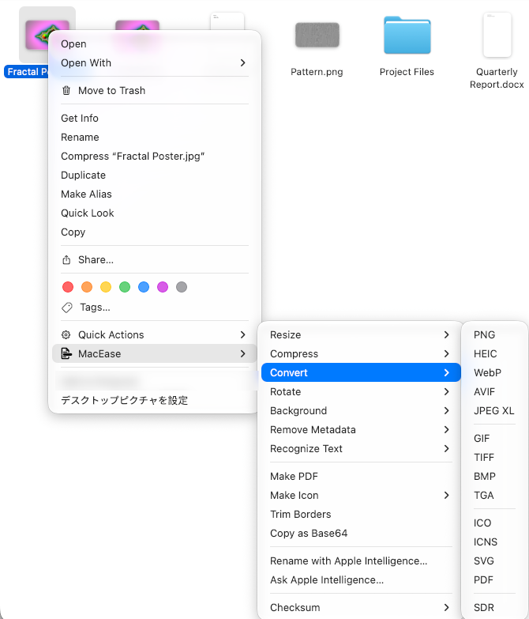
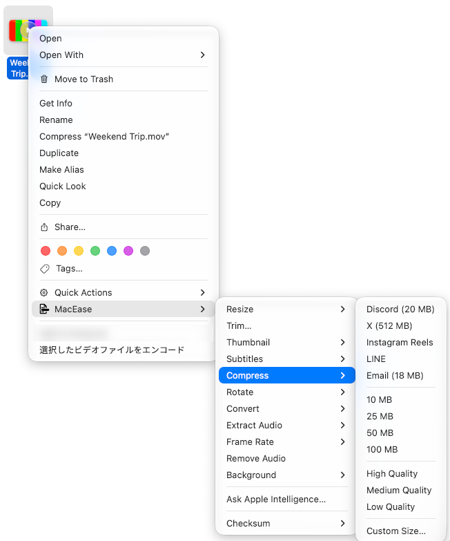
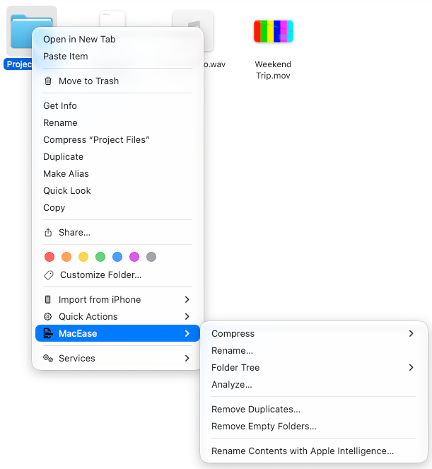
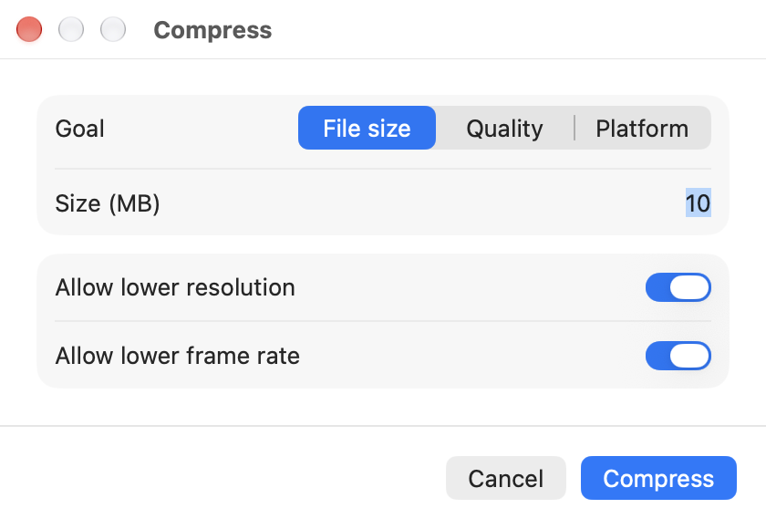
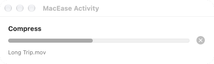
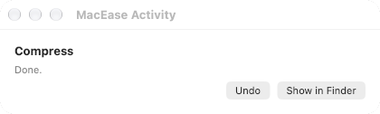
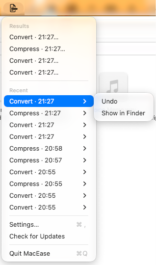
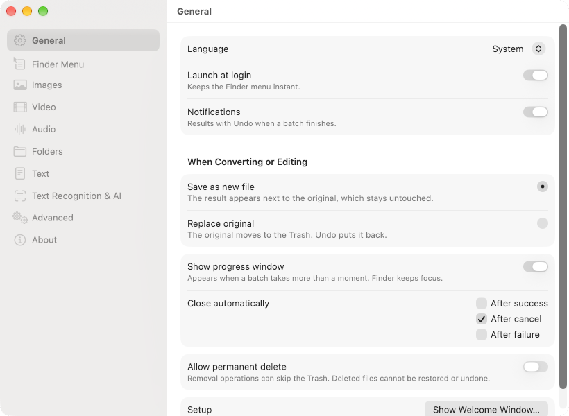
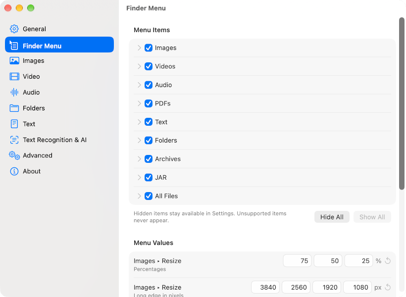

<div align="center">


# MacEase

**English | [日本語](README.ja.md)**

**Right-click and done.**

Convert, compress, and edit files and folders straight from Finder's
right-click menu, without opening another app.



</div>

---

## Installation

1. Download `MacEase-<version>.dmg` from
   [Releases](https://github.com/TKY-27/MacEase/releases) and check its
   SHA-256 against the checksum on the release page.
2. Open the DMG and drag **MacEase** to **Applications**.
3. Open MacEase. macOS blocks it the first time because it is not notarized.
4. Open **System Settings > Privacy & Security**, scroll down, and click
   **Open Anyway** next to MacEase, then confirm.
   Alternatively, run:
   ```sh
   xattr -dr com.apple.quarantine /Applications/MacEase.app
   ```
5. In the Welcome window, enable the Finder extension. Allow notifications
   if you want completion banners, then click **Done**.

Release builds use a self-signed certificate and are not notarized by Apple.
You can also [build from source](#build-from-source).

After setup, select files or folders in Finder, right-click, and choose
**MacEase**. Open **Settings** from the MacEase menu bar icon. Opening MacEase
again shows Welcome until setup is done, then Settings.

---

## Features

**Your originals stay safe.**

By default, every conversion and edit saves a new file next to its source,
with a numbered name when needed to avoid overwrites. Exports and extracts
always keep their sources. If you prefer, **Settings > General** can replace
originals instead: MacEase verifies the output before moving the original to
the Trash. Undo moves created outputs to the Trash or restores replaced
originals. It can skip files that changed since, or originals no longer in the
Trash. Permanent deletion is off by default, requires confirmation, and cannot
be undone.

Select as many files as you like. A selection of one file kind shows its
operations directly; mixed selections group operations by kind and count.
Choosing a preset or format runs it immediately. Items ending in **…** open a
window for input, review, or confirmation.

### Images

| Operation | What it does |
| --- | --- |
| **Resize** | Scale by percentage or long edge in pixels, or enter a **Custom Size…** |
| **Compress** | Platform presets, quality levels, or a **Custom Size…** target |
| **Convert** | PNG, JPEG, HEIC, WebP, AVIF, JPEG XL, GIF, TIFF, BMP, TGA, ICO, ICNS, SVG, or PDF; **SDR** for supported HDR images |
| **Rotate** | Right-angle turns and an extra editable angle; **Flip** horizontally or vertically |
| **Background** | Remove it, or replace it with a green, blue, or custom color, or a blur |
| **Remove Metadata** | Strip all metadata, location only, or selected fields |
| **Recognize Text** | Read text from the image, then copy it, save it as `.txt`, or show it |
| **Make PDF** | Combine selected images into one PDF, with a page-order window for several |
| **Make Icon** | Export a macOS `.icns`, a Windows `.ico`, or an iOS AppIcon set |
| **Trim Borders** | Crop away uniform borders |
| **Copy as Base64** | Copy the image as a `data:` URI (hidden by default) |

TGA conversion appears when ImageIO supports reading and writing it. PSD
exports use the stored composite and offer PNG, JPEG, or TIFF, keeping the
layered original. Decodable camera RAW files also keep their originals. SVG
output can trace paths or embed a PNG.

### Videos



| Operation | What it does |
| --- | --- |
| **Resize** | Scale by percentage or to a standard height, or enter a **Custom Size…** |
| **Trim…** | Keep only the part you mark |
| **Thumbnail** | Save the first, middle, or a chosen frame as an image |
| **Subtitles** | Transcribe to SRT, WebVTT, or plain text, or export translated SRT |
| **Compress** | Discord, X, Instagram Reels, LINE, and Email presets, fixed size targets, quality levels, or a **Custom Size…** |
| **Rotate** | Right-angle turns and an extra editable angle; **Flip** horizontally or vertically |
| **Convert** | MP4, MOV, M4V, MKV, WebM, AVI, or FLV; GIF, animated WebP, or APNG; **SDR** for supported HDR video |
| **Extract Audio** | Save the soundtrack as M4A (AAC or ALAC), MP3, AAC, WAV, AIFF, FLAC, Ogg Vorbis, or Opus |
| **Frame Rate** | Change the frame rate |
| **Remove Audio** | Drop the audio tracks |
| **Background** | Export with a transparent, colored, or blurred background |

### Audio

| Operation | What it does |
| --- | --- |
| **Convert** | MP3, M4A (AAC or ALAC), raw AAC, WAV, AIFF, FLAC, Ogg Vorbis, Opus, or CAF (PCM or ALAC) |
| **Subtitles** | Transcribe to SRT, WebVTT, or plain text, or export translated SRT |
| **Compress** | Bitrate presets or a **Custom Size…** target |
| **Normalize Loudness** | Match a loudness target |
| **Trim…** | Keep only the part you mark |

Subtitles use Apple's on-device Speech and Translation frameworks.

### PDFs

| Operation | What it does |
| --- | --- |
| **Merge** | Combine two or more PDFs in the order you choose |
| **Export as Images** | PNG or JPEG pages in a folder or next to the PDF, or one multipage TIFF |
| **Export as Text** | Save the text, using OCR for scanned PDFs |
| **Compress** | Make the PDF smaller |
| **Rotate** | Turn every page |
| **Extract Pages…** | Save the pages you pick as a new PDF |
| **Split into Pages** | Save one PDF per page |

### Documents and text

| Operation | What it does |
| --- | --- |
| **Convert** | Export rich documents, render HTML or Markdown, and convert structured text and subtitle files (see [Conversion formats](#conversion-formats)) |
| **Encoding** | Change to UTF-8, UTF-8 with BOM, UTF-16, or Shift_JIS |
| **Line Endings** | Normalize to LF or CRLF |
| **Pretty Print / Minify / Sort Keys** | Format JSON. Sorting supports key comparison, direction, pinned keys, and optional sorting of primitive arrays |

### Folders



| Operation | What it does |
| --- | --- |
| **Compress** | Pack the folder into ZIP, 7z, TAR, or tar.gz |
| **Rename…** | Rename the contents with a live preview |
| **Folder Tree** | Copy the folder structure or save it as a file |
| **Analyze…** | Report disk usage across the selected folders and export it as CSV, JSON, HTML, plain text, or Markdown |
| **Remove Duplicates…** | Find verified duplicates and move the extra copies to the Trash |
| **Remove Empty Folders…** | Find empty folders and move them to the Trash after confirmation |

Duplicate removal asks which copy to keep by default. A saved policy can keep
the oldest or newest by modification time and move the other copies to the
Trash automatically. Filters cover size, empty files, names, and modification
times. Copies are compared byte by byte, and at least one copy is retained.
Folder, filename, and extension exclusions apply to all folder scans or to
individual features.

### Archives and other files

| Operation | What it does |
| --- | --- |
| **Extract** | Unpack ZIP, 7z, TAR, gz, bz2, xz, or RAR into a new folder |
| **Decompile** | Turn a JAR into Java source with bundled CFR and an installed Java runtime |
| **Checksum** | Calculate SHA-256, MD5, SHA-1, or SHA-512 for any file |

### Apple Intelligence

| Operation | What it does |
| --- | --- |
| **Rename with Apple Intelligence…** | Preview and confirm content-based names for images and PDFs |
| **Rename Contents with Apple Intelligence…** | The same for the images and PDFs directly inside a folder |
| **Ask Apple Intelligence…** | Turn a request into a plan of supported image, video, or audio operations, review it, then run it |

### Presets

Compress offers bundled targets for Discord, X, Instagram, LINE, email, and the
web. You can edit them in **Settings > Finder Menu**. Their values are app
defaults, not a guarantee of a service's current upload limits.

### Panels, progress, and Undo

**Custom Size…** appears only under **Resize** and **Compress**. **Flip** is
under **Rotate**, animation exports are under video **Convert**, and HDR
conversion is **Convert > SDR**. Other windows collect required input, confirm
removals, or show results. PDF merge and Make PDF from multiple images open a
page-order window.



Batches still running after 0.8 seconds appear in **Activity**, without taking
focus from Finder. Use **Stop** to cancel a batch. Closing the window leaves
jobs running. Folder scans also show progress there.

<br>


With default settings, clean successes close automatically. Warnings, skipped
files, and failures remain when Activity is visible. A completion banner
appears when the result is not already retained there, if notifications are
enabled. Use **Show in Finder** or **Undo** where available. Recent batches
also appear in the menu bar, each with **Undo** and **Show in Finder**.



---

## Conversion formats

| From | To |
| --- | --- |
| **PNG, JPEG, HEIC, WebP, AVIF, JPEG XL, GIF, TIFF, BMP, TGA, ICO, ICNS, SVG** | Any other format in this row, or PDF |
| **PSD** | PNG, JPEG, TIFF |
| **Camera RAW** | Any image format in the first row, or PDF |
| **Animated GIF, APNG, animated WebP** | GIF, APNG, animated WebP, keeping every frame |
| **HDR JPEG, HEIC, AVIF, JPEG XL, PNG** (single image) | SDR |
| Images → **Make PDF** / **Make Icon** | PDF / ICNS, ICO, AppIcon set |
| **MP4, MOV, M4V, MKV, WebM, AVI, FLV** | Any other format in this row |
| Video → **Convert** | GIF, animated WebP, APNG |
| Video → **Extract Audio** | M4A (AAC or ALAC), MP3, AAC, WAV, AIFF, FLAC, Ogg Vorbis, Opus |
| **HDR MP4, MOV, M4V** (including supported Dolby Vision 8.4 base layers) | SDR |
| **MP3, M4A (AAC or ALAC), raw AAC, WAV, AIFF, FLAC, Ogg Vorbis, Opus, CAF (PCM or ALAC)** | Any format in this row |
| Audio or video → **Subtitles** | SRT, WebVTT, plain text, translated SRT |
| **PDF** | PNG or JPEG pages, multipage TIFF, TXT |
| **DOCX, ODT, RTF, RTFD** | PDF, TXT |
| **HTML** | Source TXT, rendered TXT, PDF |
| **Markdown** | Source TXT, HTML, PDF |
| **CSV** | TXT, JSON, XML, HTML, Markdown |
| **JSON** | TXT, CSV, XML, XML or binary plist, YAML, TOML |
| **XML** | TXT, JSON |
| **INI, CFG, CONF** | TXT, JSON, XML |
| **YAML, TOML** | TXT, JSON |
| **XML or binary plist** | JSON |
| **SRT, WebVTT** | Source TXT, the other subtitle format |
| **Other recognized text files** | TXT, except files already classified as TXT |
| **Folder** | ZIP, 7z, TAR, tar.gz |
| **ZIP, 7z, TAR, gz, bz2, xz, RAR** | An extracted folder |
| **JAR** | A folder of decompiled Java source |
| Text encodings | UTF-8, UTF-8 with BOM, UTF-16, Shift_JIS |
| Line endings | LF, CRLF |

AIFF-C input depends on its codec. Container support does not imply support
for every codec inside it. SDR-to-HDR conversion, WMA, AV1 video encoding, and
RAR creation are not implemented. Media operations act on selected files,
without scanning folders for media.

<details>
<summary><b>Limits and safeguards</b></summary>

Document export uses basic rich-text reflow and can change Office layouts.
HTML rendering blocks scripts and external resources and exports one continuous
PDF page. Markdown omits raw HTML and unsafe links. Structured conversions can
lose comments and formatting and reject unsupported value mappings. JSON to CSV
requires an array of flat objects. Subtitle conversion accepts a plain-text
subset and rejects unsupported styling or metadata. These exports keep their
sources in either output mode.

Image conversions refuse to discard animation frames or TIFF pages. When a new
image file cannot retain transparency or HDR, supported paths flatten against
the chosen background or tone-map to SDR and report a warning. Image edits and
format conversions in Replace mode refuse unrequested transparency or HDR loss.
Explicit **Convert > SDR** follows the selected output mode, checks the content,
and skips SDR inputs. Video edits in either output mode refuse multiple video
or audio tracks and streams they cannot preserve. Explicit exports keep the
source and report omitted streams.

</details>

[docs/SPEC.md](docs/SPEC.md) describes the target product, including acceptance
criteria that are not all verified on every supported macOS version.

---

## Settings

Open **Settings** from the menu bar icon. Changes apply immediately.



- **General** – Language, launch at login, notifications, **Save as new file**
  or **Replace original**, the Activity window and when it closes, permanent
  deletion, and the Welcome window.
- **Finder Menu** – Show or hide each kind, operation, preset, and format, and
  edit resize and compression values, an extra rotation angle, and platform
  presets. Some formats and utilities are hidden by default.
- **Images**, **Video**, **Audio**, **Folders**, **Text**, and **Text
  Recognition & AI** – Quality, background, animation, audio, subtitle, OCR,
  PDF, folder, and text defaults, including duplicate matching and exclusion
  rules.
- **Advanced** – **Reset All Settings…** keeps history and edited platform
  presets.
- **About** – Version and **Third-Party Notices**.



---

## Requirements

| Requirement | Details |
| --- | --- |
| **Mac** | Apple Silicon, macOS 26 or later |
| **Finder extension** | Enabled, for the right-click menu |
| **Apple Intelligence** | Enabled with its on-device model available, only for AI features. Other operations do not require it. |
| **Speech and Translation assets** | Supported, installed Speech language assets for transcription and Translation models for translated subtitles. MacEase reports missing assets. |
| **Java runtime** | Discoverable by macOS, only for JAR decompilation |

Processing runs on your Mac. The app checks GitHub for updates. Some Apple
features require installed language assets or models.

---

## FAQ

<details>
<summary><b>MacEase does not appear in the Finder menu</b></summary>

Enable the Finder extension from the Welcome window or
**System Settings > General > Login Items & Extensions**. While it is off after
setup, the menu bar icon shows an attention badge. Some items appear only for
matching selections, and some formats and utilities are hidden by default;
**Settings > Finder Menu** shows them.

</details>

<details>
<summary><b>Where do the new files go?</b></summary>

Next to their sources, in the same folder. If a name is taken, MacEase adds a
number instead of overwriting. With **Replace original**, MacEase verifies the
result before moving the original to the Trash.

</details>

<details>
<summary><b>Can I undo an operation?</b></summary>

Yes. Use **Undo** in Activity, in the completion banner, or under **Recent** in
the menu bar. Undo moves created outputs to the Trash or restores replaced
originals. Removals go to the Trash unless you allow and confirm permanent
deletion, which cannot be undone.

</details>

<details>
<summary><b>Why does macOS block MacEase on first launch?</b></summary>

Release builds use a self-signed certificate and are not notarized by Apple.
Follow steps 3 and 4 of [Installation](#installation), or build from source.

</details>

<details>
<summary><b>Does MacEase upload my files?</b></summary>

No. Processing runs on your Mac. The app checks GitHub for updates, and macOS
may download Speech, Translation, or Apple Intelligence assets that those
features require.

</details>

---

## Build from source

Requirements: Apple Silicon Mac, macOS 26 or later, Xcode 26 or later, and
Homebrew. Xcode 27 is required to build macOS 27-specific features.

```sh
git clone https://github.com/TKY-27/MacEase.git
cd MacEase
make bootstrap
make build
make test
```

Before first launch, copy `build/DerivedData/Build/Products/Debug/MacEase Dev.app`
to `~/Applications` or `/Applications`. Welcome cannot finish outside those
folders. Enable the Finder extension from Welcome or
**System Settings > General > Login Items & Extensions**.

See [CONTRIBUTING.md](CONTRIBUTING.md) for details.

### Architecture

A sandboxed Finder Sync extension builds the context menu from a catalog written
by the menu bar app. It forwards the selected operation and file paths through
a token-checked URL scheme. The host runs jobs and presents input panels,
Activity, and Settings. `Packages/MacEaseKit` contains `MenuCatalog`, `Engine`,
and `Formats`.

Apple frameworks provide native document, image, media, OCR, speech, and
translation support. Bundled Swift package dependencies include **swift-cmark**
for Markdown and **Yams**, including libyaml, for YAML. Vendored **toml++** runs
behind an owned C bridge for TOML. Other format support uses permissively
licensed libraries, including libwebp, libavif, libjxl, libvpx, libopus, and
libarchive, plus independent implementations such as the MP3 and GIF encoders,
Matroska and WebM containers, and SVG tracing.

Details: [docs/SPEC.md](docs/SPEC.md) and [docs/adr/](docs/adr/).

---

## Contributing

Issues and pull requests are welcome. Read
[CONTRIBUTING.md](CONTRIBUTING.md) and the
[Code of Conduct](CODE_OF_CONDUCT.md). Report security issues privately as
described in [SECURITY.md](SECURITY.md).

## Acknowledgments

[Flect](https://github.com/Konayukiw/Flect), a Windows Explorer toolkit, is the
reference for menu interactions and features. MacEase independently implements
that design for macOS without reusing Flect code or assets.

## License

[MIT](LICENSE). Bundled dependencies retain their own licenses, including
swift-cmark's BSD and MIT notices, Yams and libyaml's MIT licenses, and
toml++'s MIT license. Their license texts are in `Vendor/licenses/` and are
included with the native library notices in the app's `THIRD_PARTY_NOTICES.txt`.
Open **Settings > About > Third-Party Notices** to read them.
