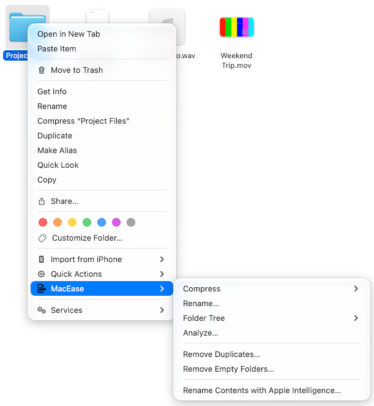
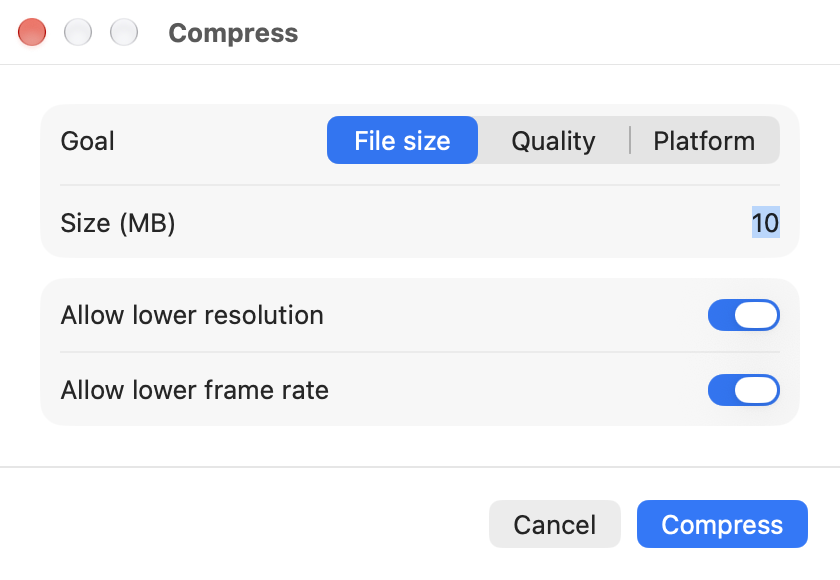
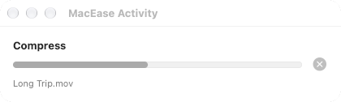
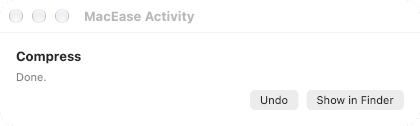
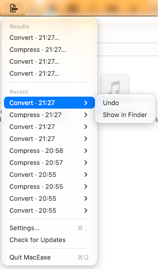
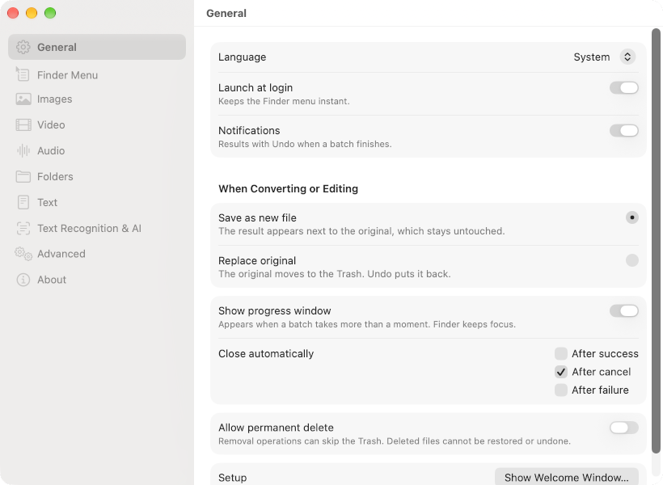
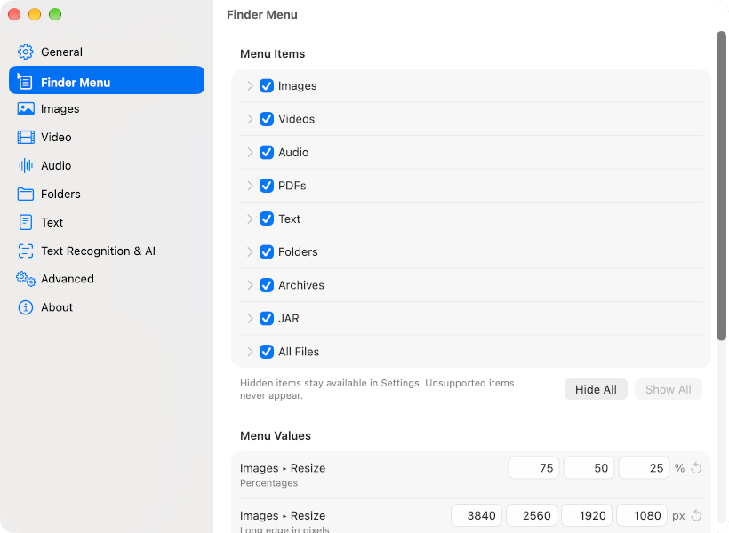

<div align="center">


# MacEase

**English | [日本語](README.ja.md)**

**Right-click and done.**

Convert, compress, and edit files and folders straight from Finder's
right-click menu, without opening another app.

</div>

---

Each file kind has its own menu: the operations you use most appear directly
inside **MacEase**, and the rest are under **More**. In **Settings > Finder
Menu**, drag groups between **MacEase Menu**, **More** and **Hidden**, put
commands such as **yt-dlp…** straight into Finder's own menu, reorder them, and
choose which choices each group shows. Rotate/Flip and Convert choices move
together. Pruning unavailable operations never fills their places from More.

## Installation

1. Download `MacEase-<version>.dmg` from
   [the official download page](https://macease-site.pages.dev/#download) and
   check its SHA-256 against the published checksum.
2. Open the DMG and drag **MacEase** to **Applications**.
3. Open MacEase. macOS blocks it the first time because it is not notarized.
4. Open **System Settings > Privacy & Security**, scroll down, and click
   **Open Anyway** next to MacEase, then confirm.
   Alternatively, run:
   ```sh
   xattr -dr com.apple.quarantine /Applications/MacEase.app
   ```
5. In the Welcome window, enable the Finder extension. Allow notifications
   if you want completion banners, then click **Done**.

Release builds use a self-signed certificate and are not notarized by Apple.
The app, Finder extension and bundled executables enable Hardened Runtime.
The host is unsandboxed; the Finder extension is sandboxed. Interpreter and
media/audio helper exceptions are documented in [SECURITY.md](SECURITY.md).
You can also [build from source](#build-from-source).

After setup, select files or folders in Finder, right-click, and choose
**MacEase**. Open **Settings** from the MacEase menu bar icon. Opening MacEase
again shows Welcome until setup is done, then Settings. To hide the icon, turn
off **Settings > General > Show in menu bar**; open MacEase again to reach
Settings.

**Settings > Folder Access** lists standard and added folders. Use **Add Folder…**
here or in Welcome, check access, and open a location in Finder. Registration
is separate from macOS permissions. Removing an entry does not revoke access.
If an iCloud folder suppresses the MacEase menu, use **Services > MacEase…**
(Finder may show it directly in the context menu). If macOS leaves
an access request waiting, select the affected folder with **Add Folder…**,
restart MacEase, and retry. This does not require Full Disk Access.

---

## Features

### Finder Preview

Turn on **Finder Preview** from the MacEase menu in Finder, the menu bar menu
or **Settings > Finder Windows**. A light panel then docks beside the front
Finder window whenever one is visible, follows the selection, and comes back
after Finder or MacEase relaunches. The close button or Command-W turns it off
again; closing a Finder window does not. Drag its outer edge to resize it. With
several files selected, the arrows in its top bar or Command-Option-Left and
Command-Option-Right step through them.

The panel shows the file itself. Text and code have line numbers, syntax
highlighting for 47 languages and an encoding menu (including UTF-16, UTF-32,
Shift_JIS, EUC-JP, GB18030, Big5 and EUC-KR); files such as `Makefile`,
`Dockerfile` or `Gemfile` open as text by name. Diff and patch files tint
added and removed lines across the whole row. Hidden characters, such as
zero-width spaces or controls that change text direction, are marked in place
and named when you point at them; a file containing direction-changing or
hidden tag characters also shows a warning above the text. HTML, Markdown and
SVG switch between **Preview** and **Source**; JSON and property lists can be
formatted. CSV and TSV files open as a **Table** you can sort by clicking a
column header, search with Command-F and copy rows from, or as **Source**; the
table shows up to 50,000 rows and 256 columns. Images open at **Fit**,
with **100%**, double-click zoom, Live Text, a transparency checkerboard and an
**Info** popover; animated images play as often as the file says. PDFs show the
current page, a table of contents, Fit Width and Actual Size, and an unlock
field for password-protected files. Fonts show their name, style, glyph count
and sample text at several sizes; for font collections, a menu and
**Previous Face** and **Next Face** switch between faces. Archives (ZIP, TAR
and compressed TAR) show their contents as a list with search and sorting,
without extracting anything; 7z and RAR use the macOS preview. Audio shows its artwork, title and artist with a volume control,
and video uses the system player. Video and audio that macOS cannot play
directly, such as MKV, WebM, Ogg, FLAC, WMV or WMA, offer **Convert and Play**
for up to 10 minutes of video or 30 minutes of audio; nothing is converted
until you press it, and files downloaded from the internet are never
converted. Folders and other files use Quick
Look. Press Command-F to find text in text, code, Markdown, HTML and PDF
previews. Nothing in the panel edits or saves files.

**What the preview does with files from the internet.** HTML opens in Source.
Its Preview is static and offline: scripts don't run, links and forms do
nothing, and only files next to it can load. **Run Scripts with Network Access**
allows both for that file until it changes or MacEase quits. HTML in a folder
you add under **Trusted Folders** opens with scripts and network access. Files
macOS marks as downloaded from the internet stay restricted even in a trusted
folder: their HTML renders sealed from the text alone, Markdown shows no images,
and media is not converted. A file whose name doesn't match its content gets a
warning, and binary content with a text name isn't shown.

Finder Preview needs **Accessibility** to place the panel beside Finder windows
and **Automation** for Finder to follow the selection. macOS asks for them only
when you turn the preview on; **Settings > Finder Windows** shows both and
links to System Settings. Each file type can be switched back to the macOS
preview there, along with the code font, line wrapping and font sample text.
Full screen, Spaces and Finder tabs are untested.

**Conversions and edits keep originals by default. HatchZip extraction usually consumes its archive.**

By default, conversions and edits outside Finder Preview save a new file next to its source,
with a numbered name when needed to avoid overwrites. Exports and ordinary
extracts keep their sources. If you prefer, **Settings > General** can replace
originals instead: MacEase verifies the output before moving the original to
the Trash. Undo moves created outputs to the Trash or restores replaced
originals. It can skip files that changed since, or originals no longer in the
Trash. Other permanent deletion is off by default, requires confirmation, and
cannot be undone.

**Extract with HatchZip is the exception:** it starts without confirmation,
progressively releases source archive bytes as verified output becomes durable,
and does not retain the original archive or offer Undo. Archives whose file
names need the Japanese Windows encoding (see
[Archives and other files](#archives-and-other-files)) are extracted to a new
folder instead and keep the archive.

Select as many files as you like. A selection of one file kind shows its
operations directly; mixed selections group operations by kind and count.
Choosing a preset or format runs it immediately. Items ending in **…** open a
window for input, review, or confirmation. Image and video menus start with
**Edit**, **Convert**, **Compress**, then **Resolution**.

### Storage bar

While Finder shows its status bar (**View > Show Status Bar**), MacEase draws a
thin bar over it in the front Finder window: the disk's name, a capacity bar in
your accent colour, the space available, and the number of selected items. In
icon view it leaves Finder's icon-size slider uncovered. It never opens or
measures the selected files, so it never causes file-access prompts. It uses the
same Accessibility permission as Finder Preview and Automation for the selection
count; without Automation it shows capacity only. Turn it off in
**Settings > Finder Windows**. Its position over Finder's bar is still to be
checked against a real Finder window.

### Finder commands

The MacEase menu also offers commands for the selection itself:

| Command | What it does |
| --- | --- |
| **New File** | Create an empty Text or Markdown file, or a blank Rich Text or Word document, named **Untitled**, in the folder you right-clicked; Undo removes it |
| **Cut** / **Move Here** | Cut items, then move them into another folder; Undo moves them back |
| **Copy Path** | Copy the paths, one per line, or **Copy Path for Terminal** with shell quoting |
| **Open Terminal Here** | Open Terminal in the folder, or in the folder of a selected file |

**Moving to another disk copies the items and keeps the originals** where they
were; MacEase never deletes them, and Activity says where each original stayed.
Undo then removes the copy if you haven't changed it. Like any group, these
commands can be moved to More, into Finder's own menu, or hidden in
**Settings > Finder Menu**.

### Images

| Operation | What it does |
| --- | --- |
| **Edit Photo…** | Edit one or several photos; apply adjustments to selected photos or all, then refine each separately; add redactions, boxes, arrows and text |
| **Convert** | PNG, JPEG, HEIC, WebP, AVIF, JPEG XL, GIF, TIFF, BMP, TGA, ICO, ICNS, SVG, or PDF; **SDR** for supported HDR images |
| **Compress** | Platform presets, quality levels, or a **Custom Size…** target |
| **Resolution** | Scale by percentage or long edge, including 720, 480 and 360 px, or enter a **Custom Size…**; low-resolution presets never enlarge |
| **Upscale Photo…** | Local Swin2SR 2× upscaling for one opaque, 8-bit SDR still image up to 1 MP; always creates a new PNG |
| **Trace to SVG…** | Compare a static PNG with editable SVG paths; choose 1–8 colors and three detail levels, then save a new file |
| **Rotate** | Right-angle turns and an extra editable angle; **Flip** horizontally or vertically |
| **Background** | Remove it, or replace it with a green, blue, or custom color, or a blur |
| **Remove Metadata** | Strip all metadata, location only, or selected fields |
| **Recognize Text** | Read text from the image, then copy it, save it as `.txt`, or show it |
| **Make PDF** | Combine selected images into one PDF, with a page-order window for several |
| **Make Icon** | Export a macOS `.icns`, a Windows `.ico`, or an iOS AppIcon set |
| **Trim Borders** | Crop away uniform borders |

TGA conversion appears when ImageIO supports reading and writing it. PSD
exports use the stored composite and offer PNG, JPEG, or TIFF, keeping the
layered original. Decodable camera RAW files also keep their originals. SVG
output can trace paths or embed a PNG. The separate **Trace to SVG…** action opens a
comparison for one static PNG and always saves editable paths as a new SVG.
It works best for logos and flat shapes. Photos, editable text, and reconstructed
gradients are outside its scope. Review any metadata, transparency, or HDR warning
before saving.

The photo and video editors use a resizable dark workspace like familiar
editing apps. The toolbar centres the tools and keeps Compare, Undo/Redo,
Cancel and Save on the right; Undo's dropdown holds **Reset All Edits**. Video
plays from the transport bar under the viewer, and adjustments are grouped into
Light, Color and Detail in the inspector. When no segment is selected, the
inspector says to select one in the timeline. Save or Return always creates a
new file. The editor stays open with compact progress while saving, closes on
success, and stays open with the failure reason so you can adjust and retry.
Its dropdown offers
**Replace Original**, with a Trash/Undo hint, independently of the global
output setting. Replacement is disabled when a new file is required, with a
reason in the output summary. Drag a crop edge or corner, or
enter selection percentages; choose free/original, 1:1, 4:3, 3:2, 4:5 or 16:9.
Use Compare Original, per-adjustment reset and session Undo/Redo. Photos add
black point, sharpness, noise reduction, vignette and automatic correction.
Styles are independent presets, not Apple's Photographic Styles. Photo zoom
offers **Fit**, **100%**, **200%** and **400%**, where 100% shows one image
pixel per screen pixel, and shows the current level.
**Markup** adds mosaic, blur or solid redaction, boxes, arrows and one-line text
to photos and videos, up to 50 items. Redactions stay on the covered content
when you crop or rotate later; mosaic and blur can sometimes be partly reversed,
solid cannot. Markup on HDR media saves a new SDR file.
For several photos, use the file list to switch sources. **Copy Edits to Selected**
or **Copy Edits to All Photos** copies the current photo's edits, then change each independently. Auto Enhance analyzes every
photo separately. Each source retains its own preservation policy.
Photo adjustments use an interactive preview followed by a refined render.
The video player surface stays in place while frames are prepared. Histograms,
keyframe-mode controls and slider tick rows are absent.
HDR color edits explain that a new SDR file is required and always keep the original.
Animations and multipage images cannot be opened in Edit Photo; RAW renders
are saved in a writable format while retaining the RAW source.

### Videos

| Operation | What it does |
| --- | --- |
| **Edit Video…** | Join several videos; split, delete, duplicate, reorder, freeze and reverse segments, remove silent pauses, add background music and markup, with segment adjustments and global geometry |
| **Convert** | MP4, MOV, M4V, MKV, WebM, AVI, or FLV; GIF, animated WebP, or APNG; **SDR** for supported HDR video |
| **Compress** | Discord, X, Instagram Reels, LINE, and Email presets, fixed size targets, quality levels, or a **Custom Size…** |
| **Resolution** | Scale by percentage or to a 2160p/1080p/720p/480p/360p short edge; **Custom Size…** fits a box |
| **Playback Speed** | 0.5, 0.75, 1.25, 1.5, 2 and 4× presets, plus arbitrary **Custom Speed…** from 0.5–4×; preserve pitch, including batch processing |
| **Thumbnail** | Save the first, middle, or a chosen frame as an image |
| **Subtitles** | Transcribe to SRT, WebVTT, or plain text, or export translated SRT |
| **Rotate** | Right-angle turns and an extra editable angle; **Flip** horizontally or vertically |
| **Extract Audio** | Copy the original soundtrack without re-encoding, or explicitly convert to M4A (AAC or ALAC), MP3, AAC, WAV, AIFF, FLAC, Ogg Vorbis, or Opus |
| **Frame Rate** | Change the frame rate |
| **Remove Audio** | Drop the audio tracks |
| **Background** | Export with a transparent, colored, or blurred background |

Edit one or several source videos as an ordered sequence of segments. Use
**Add Videos…** in the timeline bar to append sources. Segment Start, End and
Length use the same m:ss.sss timecode as the timeline; typed seconds are also
accepted. Speed uses 0.5×, 1×, 1.5×, 2× and 4× presets or a custom value from
0.5–4×. Export resolution sits in its own section at the bottom of the
inspector. Split at the playhead
with **Command-B**, delete a selected segment with **Backspace** to close the gap,
duplicate it, or drag to reorder. Visible controls and the timeline context menu
provide these actions too. Each action or drag supports session Undo/Redo;
editing shortcuts leave focused text fields available for typing. Speed, volume
and color/style settings apply to the selected segment; crop, rotation and
resolution apply to the whole output. Joined videos always save a new MP4
(H.264, SDR, opaque). The first source sets the initial canvas and frame rate;
other sizes fit with black borders. Silent sources contribute silence. Review
the HDR, transparency and metadata disclosure before saving. Multiple tracks
and transitions are outside this editor's scope.

Press **C** to select the segment under the playhead. During playback the
timeline scrolls along with the playhead while it was visible when playback
started; scrolling or zooming the timeline yourself stops this. Controls that
are unavailable explain why in their tooltip. The timeline also describes its
segments, playhead, markup, music and silence ranges to VoiceOver and offers
segment edits as VoiceOver actions; this has not been tested with VoiceOver
itself.

**Save Frame** (Shift-Command-S) saves the edited frame at the playhead as an
image next to the video. **Freeze Frame** (Option-F) holds the frame at the
playhead for two seconds; set 0.1–30 seconds in the inspector. **Reverse** plays
a segment backwards; **segments up to one minute can be reversed**, so split a
longer one first. Reversing renders a temporary copy, which can take a while and
needs free disk space, and an edit with a reversed segment always saves a new
H.264 MP4 (SDR, opaque). **Remove Silence…** finds pauses below a level you set
and longer than a length you set, shows them on the timeline, and removes them
in one step. **Add Music…** plays one song from the start of the video under its
own sound, with volume and a start position in the song, and fades it out over
the last second; MP3, AAC/M4A, WAV, AIFF, CAF, FLAC, Ogg and Opus are accepted.
Up and Down Arrow jump between segment boundaries, and clicking the time display
lets you type a position.

Video and audio trimming share a yellow selection with draggable ends. Zoom with
Command-scroll, a trackpad pinch, the zoom slider or Command-plus/minus; use
**Fit** to see the whole timeline. The pink hover line previews silently; clicking
sets the white playhead. Trim ends snap within eight screen points of the playhead
and segment boundaries; hold Option to disable snapping. Press **I** or **O**, or use
the segment menu (video) or the buttons beside Start and End (audio), to place a
boundary at the playhead. Audio trim times can be typed as `1:05.250` or seconds.
Choose **Fade In** and **Fade Out** for an audio trim or a video segment; video clips
show their soundtrack as a waveform under the thumbnails. Toggle loop playback in the
transport bar, and use **J**, **K** and **L** to play backward, pause and play forward
(press again for 2×, 4× or 8×).
One drag is one Undo operation.

**Extract Original Audio** ignores bitrate settings and copies compatible audio
without normalization, volume changes or re-encoding. Unsupported formats or
unrepresentable timing fail explicitly. **MP3 (Lossy Conversion)** and other MP3
outputs use the bundled LAME encoder; converting to MP3 is lossy. Unsupported
audio tags block replacement; New File retains the source and reports the loss.

### Audio

| Operation | What it does |
| --- | --- |
| **Convert** | MP3, M4A (AAC or ALAC), raw AAC, WAV, AIFF, FLAC, Ogg Vorbis, Opus, or CAF (PCM or ALAC) |
| **Subtitles** | Transcribe to SRT, WebVTT, or plain text, or export translated SRT |
| **Compress** | Bitrate presets or a **Custom Size…** target |
| **Normalize Loudness** | Match a loudness target |
| **Trim…** | Keep only the part you mark |
| **Enhance Audio…** | Local speech cleanup (16 kHz mono, up to 10 minutes) or vocals and instrumental (two 44.1 kHz stereo WAVs, up to 5 minutes) |

Subtitles use Apple's on-device Speech and Translation frameworks.

Video and audio that macOS and MacEase cannot decode themselves, such as WMV,
MPEG, VOB, RealMedia, MXF, WMA, DTS, WavPack or Monkey's Audio, are first
converted to a temporary copy with the bundled FFmpeg, checked against the
original, and then processed as usual. **The result is always saved as a new
file, even when Replace original is selected**, and any content or metadata
that could not be carried over is reported. The video editor does not open
these formats.

### PDFs

| Operation | What it does |
| --- | --- |
| **Edit Pages…** | Reorder or delete pages in one PDF, with selection, preview and Undo/Redo |
| **Merge** | Combine two or more PDFs in the order you choose |
| **Export as Images** | PNG or JPEG pages in a folder or next to the PDF, or one multipage TIFF |
| **Export as Text** | Save the text, using OCR for scanned PDFs |
| **Compress** | Make the PDF smaller |
| **Rotate** | Turn every page |
| **Extract Pages…** | Save the pages you pick as a new PDF |
| **Split into Pages** | Save one PDF per page |

PDF page editing follows the saved output mode. It verifies surviving annotations,
form values, outlines and internal links before publishing. Destinations on deleted
pages are removed; encrypted or permission-restricted documents may refuse editing.

### Documents and text

| Operation | What it does |
| --- | --- |
| **Convert** | Export rich documents, render HTML or Markdown, and convert structured text and subtitle files (see [Conversion formats](#conversion-formats)) |
| **Encoding** | Change to UTF-8, UTF-8 with BOM, UTF-16, or Shift_JIS |
| **Line Endings** | Normalize to LF or CRLF |
| **Pretty Print / Minify / Sort Keys** | Format JSON. Sorting supports key comparison, direction, pinned keys, and optional sorting of primitive arrays |

### Folders



| Operation | What it does |
| --- | --- |
| **Organize…** | Review content-based categories, move loose files, and optionally enable automatic organization |
| **Compress** | Pack the folder into ZIP, 7z, TAR, or tar.gz |
| **Rename…** | Rename the contents with a live preview |
| **Folder Tree** | Copy the folder structure or save it as a file |
| **Analyze…** | Report disk usage across the selected folders and export it as CSV, JSON, HTML, plain text, or Markdown |
| **Remove Duplicates…** | Find verified duplicates and move the extra copies to the Trash |
| **Remove Empty Folders…** | Find empty folders and move them to the Trash after confirmation |

Duplicate removal asks which copy to keep by default. A saved policy can keep
the oldest or newest by modification time and move the other copies to the
Trash automatically. Filters cover size, empty files, names, and modification
times. Copies are compared byte by byte, and at least one copy is retained.
Folder, filename, and extension exclusions apply to all folder scans or to
individual features.

### Automatic organization

Start from Finder or **Settings > Organization**. Review the category folders,
instructions and proposed changes before approving a policy. Existing folders
stay in place; files move only within the selected root and volume. Meaningful
filenames stay unchanged; camera, scan and other generated names may be renamed.
Apple Intelligence runs locally. Unreadable, uncertain or unavailable classification
stays in place with a reason. No content is sent to an external AI service.

Automation is an explicit per-folder choice, separate from Folder Access. It waits
two minutes by default and checks that writing has stopped. Pause each folder
individually. **Recent Organization** shows old/new paths, old-name search, category
correction and batch Undo. Saved corrections guide later classification. Undo
preserves changed or conflicting files and removes only empty folders created by
that batch. Restored files are not immediately organized again.

### Finishing recipes

Select images, videos or PDFs and choose **Finish With Recipe**. The bundled
**Web Publishing** and **Submission** recipes can be edited, duplicated or deleted
in **Settings > Finishing Recipes**. Set format, dimensions, quality, filename
suffixes and multiple outputs for each supported kind. Video thumbnails and PDF
page images or text can be included. Unsupported inputs are reported before a run.

A run freezes its settings and generates every variant from its original. It
publishes one named folder or ZIP only after every required output is verified.
Originals stay in place, and one Undo removes the completed package. Select an
output folder when inputs come from several folders. Optional total limits count
all output file bytes for folders and the actual completed ZIP size. Retries are
limited; an unattainable limit fails without publishing an incomplete package.

### Archives and other files

| Operation | What it does |
| --- | --- |
| **Extract with HatchZip** | Extract supported local ZIP, 7z, TAR, tar.gz/tgz and recognized numeric split volumes in place, consuming the archive without confirmation or Undo; archives with Japanese Windows file names are extracted to a new folder and kept |
| **Extract** | Unpack RAR into a new folder, retaining the archive |
| **Browse Contents…** | Search a ZIP hierarchy, preview selected files, and save selected files or folders without unpacking the whole archive |
| **Decompile** | Turn a JAR into Java source with bundled CFR and an installed Java runtime |
| **Checksum** | Calculate SHA-256, MD5, SHA-1, or SHA-512 for any file |
| **Share with QR Code…** | Explicitly start a temporary private-LAN HTTP share for 1–20 regular files |
| **Find Related Files…** | Read-only search for exact content and visually similar images in the chosen folder |
| **Encrypt or Decrypt…** | Create a new standard passphrase-protected `.age` file or decrypt one, retaining the source |

HatchZip uses core v0.1.10, including dot-only path, hard-link and on-disk output
verification fixes. RAR and tar.xz are not supported by HatchZip.

**HatchZip does not keep an original archive.** Keep a separate backup yourself
if you need one. Supported split names are `.zip.NNN`, `.7z.NNN` and
`.tar.gz.NNN`; a bare numeric extension is not enough. Preflight checks the
complete archive, volumes, paths, expansion limits and free space before
mutation. Unsupported cloud/File Provider and network locations, hard-linked
inputs and untrusted recovery records fail before destructive work. Existing
outputs are never overwritten.

File names are read as UTF-8 whenever possible. When Japanese is one of your
preferred languages in System Settings and every other name in the archive is
valid Japanese Windows (CP932) text, the names are read that way and the
archive is extracted by MacEase's own extractor: into a new folder, keeping the
archive, with Undo. Otherwise ZIP names are read as CP437, as before, and TAR
names that are not UTF-8 are refused before anything changes. Browse Contents
uses the same rule. A paused extraction resumes the way it started, even if
your languages changed. Archive decompression never starts an external
program.

Pause preserves extracted files and recovery state; use **Resume** in Activity,
including after relaunch. Clearing ordinary history does not remove incomplete
HatchZip recovery sessions. Completed HatchZip jobs have no Undo. Source and
output share a volume; filesystem snapshots and hole-punching support can limit
space reclaimed. Ordinary extraction is RAR-only; macOS-supported gzip, bzip2
and xz files have no extraction action here. ZIP browsing remains separate and
keeps the archive.

ZIP browsing supports up to 100,000 entries, 32 MiB of name and extra metadata,
and 256 path components. A preview can expand up to 256 MiB. Images, PDFs, audio,
video, and read-only text appear in the window; HTML and scripts are never run.
Closing removes temporary previews. Files you explicitly save remain and support Undo.

### Media downloads

Right-click an empty area in a Finder folder, or one selected folder, and choose
**yt-dlp…**. The folder becomes the destination. Paste one or more public HTTP(S)
URLs, one per line, and press Return or **Analyze** (Command-R) to inspect titles, durations and
sizes. Choose **Video**, **Audio Only** or **Images**; for video/audio, select a format, and press Return again or
**Download**. Editing the URLs clears the results, so Return analyzes again.
**Choose…** changes the destination folder for this window. The window stays
open after Download and lists each item as queued, downloading with progress,
done with **Show in Finder**, or failed with its reason and **Retry**. Closing
the window never cancels downloads. You can also drop links from a browser onto the window. When the
clipboard holds a link, **Paste Link from Clipboard** appears; macOS only reports
that a link exists until you click it. Results show each video's thumbnail.
Playlist entries start unselected; choose the entries you want before downloading.

Best-quality video in its original format is the default. The Format menu groups
choices into **No Re-encoding** (Original Format, MKV) and **Converts If Needed**
(MP4, WebM, M4A, MP3, WAV, FLAC). M4A and MP3 add a **Quality** choice of
Standard, 128, 256 or 320 kbps, applied when the audio is converted. Available resolutions come from actual video streams and show pixel dimensions, including portrait video. With multiple selections, only common resolutions are listed; when none are shared, the window explains that each item downloads at its best. A source offering one resolution cannot supply other native resolutions.
Compatible streams are copied; a format with incompatible codecs requires
re-encoding. Optional authored or automatic subtitles are saved alongside the media
as SRT or VTT in the selected language.

Two downloads run concurrently. Activity supports cancellation, retrying only failed
downloads, Show in Finder and Undo. Successful or cancelled downloads are excluded
from retries. Downloads always create new files, number duplicate names and remove
uncommitted partial files after failure or cancellation. Missing media fragments fail the download. A narrowly verified repair removes empty H.264 tail packets only when every valid video/audio packet and its timing remain unchanged; other corruption still fails.

Supported public sites are those handled by the bundled yt-dlp, including YouTube
and TikTok; provider changes can break support. Cookies, sign-in, DRM removal and
recording ongoing live streams are not supported. Published live archives can be
downloaded as ordinary videos.

Local file processing stays on your Mac. Download analysis and retrieval contact
the requested sites and their media hosts; update checks contact GitHub. Update
buttons open the official download page in the selected app language. MacEase does
not upload local files for these features. Download tools are bundled and updated
with MacEase; no user-installed Python or Homebrew is required.

In **Images** mode, gallery-dl accepts direct public post or album URLs containing
1–512 images. Recursive profile, collection and child-gallery crawling is not
supported. Images are verified before a new folder is published, with a
`MacEase Source.json` record of the page URL, retrieval time and filenames.
Video/audio downloads record the page URL in the file's WhereFroms attribute.
Recorded links are editable metadata, not proof of authorship or authenticity; MacEase
does not automatically research the web.

### Local sharing and file protection

Choose **Share with QR Code…**, select a private Wi-Fi or Ethernet interface,
and click **Start Sharing**. Scan the QR code on a device on the same trusted
network, including an Android phone, or open the displayed link in its browser.
Up to 20 selected regular files are available through a URL with a random
32-byte token. Anyone holding the link can download them while the session is
active. It expires after 15 minutes; **Stop Sharing** or closing the window
invalidates it. **HTTP is not encrypted**: use a trusted private network. There
is no cloud upload or internet port forwarding. This sharing window must stay
open, unlike Activity windows whose jobs continue after closing.

**Encrypt or Decrypt…** uses age v1.3.2 and the standard age scrypt format.
New passwords require at least 12 characters and confirmation; forgotten
passwords cannot be recovered. Passphrases are session-only and passed to the
separate tool through standard input, never arguments, environment variables,
logs or history. Encryption verifies a decrypted copy before publishing;
decryption completes authentication before publishing plaintext. Both create
new files and keep originals. See [file protection](docs/encryption.md).

### Local enhancement and related files

**Upscale Photo…** uses bundled Swin2SR through Core ML. It accepts a single
opaque, 8-bit SDR still of at most 1,000,000 pixels, rejects HDR, transparency,
animation and multiple pages, and exports a new 2× PNG without implicit
input downscaling. On an M5 with 24 GB, a 1 MP image took 134.42 seconds and
reached 1.33 GB RSS. This is an observation, not a speed or quality promise;
enhancement cannot establish authentic detail. See [upscaler](docs/upscaler.md).

**Enhance Audio…** runs bundled GTCRN or Spleeter locally on CPU in bounded
chunks. Speech cleanup exports 16 kHz mono WAV (stereo is downmixed), up to
10 minutes. Separation exports both vocals and instrumental as 44.1 kHz stereo
WAV, up to 5 minutes. Inputs must be mono or stereo. Originals are retained;
tags are not copied. The 32-bit float WAV outputs pass through 16-bit native
tool intermediates and do not recover that precision. No models download at
runtime and Apple Intelligence is not required. Missing resources fail
explicitly. See [audio models and exact provenance](docs/ai-audio.md).

**Find Related Files…** starts from one regular file and defaults to its
containing folder; **Choose Folder…** changes the search scope. Exact matches
require equal size, SHA-256 and byte-for-byte comparison. Visually similar
images use local Vision features with distance at most 0.5 and remain labelled
as similarity, not duplicates. Results can be revealed in Finder; the scan
never moves or deletes files and skips symlinks and package descendants.

### Apple Intelligence

| Operation | What it does |
| --- | --- |
| **Rename with Apple Intelligence…** | Preview and confirm content-based names for images and PDFs |
| **Rename Contents with Apple Intelligence…** | The same for the images and PDFs directly inside a folder |

### Presets

Compress offers bundled targets for Discord, X, Instagram, LINE, email, and the
web. You can edit them in **Settings > Finder Menu**. Their values are app
defaults, not a guarantee of a service's current upload limits.

### Panels, progress, and Undo

**Custom Size…** appears only under **Resolution** and **Compress**.
**Flip** is under **Rotate**, animation exports are under video **Convert**, and HDR
conversion is **Convert > SDR**. Other windows collect required input, confirm
removals, or show results. PDF merge and Make PDF from multiple images open a
page-order window.



**Activity** appears automatically if a batch is still running after two seconds,
without taking focus from Finder. Short jobs do not open it. This release enables
automatic display once for existing installations; subsequent changes in Settings
are preserved. Resetting settings enables it again. **Stop** cancels ordinary jobs;
HatchZip supports Pause. Closing the window leaves jobs running.

Completed file counts are separate from the current stage. Measurable stages use
received bytes, processed media time or PDF pages. Searches and work with unknown
totals show the stage name and an indeterminate bar. Verification and saving remain
visible until the output is committed.

Activity also shows elapsed time and per-file results. Successes keep a success
symbol even when output differences need explaining; expand **1 note** or
**{n} notes** for those secondary notes. Failures show the cause and next step.
Expand **Details** to copy available technical diagnostics when reporting an error.
**Compare…** opens successful still-image compression or conversion results
beside their originals, with synchronized zoom and position, **Fit**, **100%**,
file sizes, dimensions and disclosed palette or resolution reductions.
Replacement originals are read from their recorded Trash locations. Changed
or missing files cannot be compared.

When a file holds content MacEase can't carry over, such as timecode,
subtitles or chapters, Activity names the file and the content, explains what
leaving it out means and what happens to the original, and offers **Continue
Without …**. Nothing is written until you choose it, and it applies only to that
file as it was when you saw the question. Activity appears for such a question
even when **Show Activity automatically** is off. The editor, Audio Trim,
Finishing Recipes and Audio Enhancement ask the same question in a sheet before
they run. To skip the question for results saved as new files, choose **Save
without it** under **Settings > General > If some content can’t be kept**;
replacing an original always asks.

**Retry Failed…** retries only failed image, video and audio compression or
conversion and PDF compression, using the original settings. Target-size
compression lets you change the limit before retrying. Successful, unchanged
and cancelled files are excluded; changed inputs require a new Finder operation.
Activity keeps up to 20 results during the current app session. Dismiss a result
or close Activity to clear completed rows and their notifications; running jobs
remain available when you reopen it. Recent batches retain Undo in the menu bar.
Comparison and retry information is not retained after quitting.

Custom size limits use decimal bytes: **10 MB means at most 10,000,000 bytes**.
Image compression preserves the format and tries the original resolution first.
For large PNG reductions, it balances color detail, resolution and processing
time, resizing when allowed instead of repeatedly forcing fewer colors.
It checks reduced-color candidates and uses full-color resizing when needed.
**Allow lower resolution** is visible in
the custom-size panel and has an independent image setting. Already-small
inputs stay unchanged. Skipping optional lossless PNG optimization does not
mean compression failed; the verified output size determines whether it fits.

<br>


With default settings, clean successes close automatically. Successes with notes, skipped
files, and failures remain when Activity is visible. A completion banner
appears when the result is not already retained there, if notifications are
enabled. Successful banners include only the summary and any note count, without
note text or raw diagnostics. Use **Show in Finder** or **Undo** where available. Recent batches
also appear in the menu bar with available actions such as **Undo** and
**Show in Finder**; turn off **Show recent operations** in Settings > General to
hide them. **Finder Preview** in the menu bar menu turns the preview on or off.
HatchZip extraction has no Undo. Available updates show a menu bar indicator and
update action, with a notification once per day.

### Updates

When an update is available, **Update Available (v…)** appears first inside the
Finder **MacEase** submenu with a blue symbol. This entry, the menu bar update
item and update notifications open the same window with the available and
installed versions. Choose **Download from Official Site** to download manually,
or **Later** to close the window.

1. Quit MacEase from the menu bar.
2. Move the old MacEase in Applications to the Trash.
3. Open the downloaded file and drag MacEase into Applications.
4. Open MacEase.
5. Turn on MacEase again in **System Settings > General > Login Items & Extensions
   > Finder**. Allow folder and privacy access again when macOS asks.

The update window's **Open Extension Settings** button opens Finder extension
settings. MacEase checks GitHub for a newer version at launch and once a day;
turn off **Settings > General > Check for updates automatically** to stop that,
and use **Check for Updates** in the menu bar menu whenever you want. MacEase
does not download or install updates automatically.



---

## Conversion formats

| From | To |
| --- | --- |
| **PNG, JPEG, HEIC, WebP, AVIF, JPEG XL, GIF, TIFF, BMP, TGA, ICO, ICNS, SVG** | Any other format in this row, or PDF |
| **PSD** | PNG, JPEG, TIFF |
| **Camera RAW** | Any image format in the first row, or PDF |
| **Animated GIF, APNG, animated WebP** | GIF, APNG, animated WebP, keeping every frame |
| **HDR JPEG, HEIC, AVIF, JPEG XL, PNG** (single image) | SDR |
| Images → **Make PDF** / **Make Icon** | PDF / ICNS, ICO, AppIcon set |
| **MP4, MOV, M4V, MKV, WebM, AVI, FLV** | Any other format in this row |
| Video → **Convert** | GIF, animated WebP, APNG |
| Video → **Extract Audio** | M4A (AAC or ALAC), MP3, AAC, WAV, AIFF, FLAC, Ogg Vorbis, Opus |
| **HDR MP4, MOV, M4V** (including supported Dolby Vision 8.4 base layers) | SDR |
| **MP3, M4A (AAC or ALAC), raw AAC, WAV, AIFF, FLAC, Ogg Vorbis, Opus, CAF (PCM or ALAC)** | Any format in this row |
| Audio or video → **Subtitles** | SRT, WebVTT, plain text, translated SRT |
| **PDF** | PNG or JPEG pages, multipage TIFF, TXT |
| **DOCX, ODT, RTF, RTFD** | PDF, TXT |
| **HTML** | Source TXT, rendered TXT, PDF |
| **Markdown** | Source TXT, HTML, PDF |
| **CSV** | TXT, JSON, XML, HTML, Markdown |
| **JSON** | TXT, CSV, XML, XML or binary plist, YAML, TOML |
| **XML** | TXT, JSON |
| **INI, CFG, CONF** | TXT, JSON, XML |
| **YAML, TOML** | TXT, JSON |
| **XML or binary plist** | JSON |
| **SRT, WebVTT** | Source TXT, the other subtitle format |
| **Other recognized text files** | TXT, except files already classified as TXT |
| **Folder** | ZIP, 7z, TAR, tar.gz |
| **WMV, ASF, MPEG, VOB, M2TS/MTS, RealMedia, MXF, DV, 3GP, Ogg video** | The formats in the video row above, always as a new file |
| **WMA, AC-3, DTS, MP2, WavPack, Monkey's Audio, TTA, AMR, RealAudio, MKA** | The formats in the audio row above, always as a new file |
| **Local ZIP, 7z, TAR, tar.gz/tgz and recognized numeric split volumes** | HatchZip extraction; consumes the archive, no Undo (Japanese Windows file names: a new folder, keeping the archive) |
| **RAR** | An extracted folder, retaining the archive |
| **JAR** | A folder of decompiled Java source |
| Text encodings | UTF-8, UTF-8 with BOM, UTF-16, Shift_JIS |
| Line endings | LF, CRLF |

AIFF-C input depends on its codec. Container support does not imply support
for every codec inside it. SDR-to-HDR conversion, WMA output, AV1 video
encoding, and RAR creation are not implemented. Media operations act on selected files,
without scanning folders for media.

<details>
<summary><b>Limits and safeguards</b></summary>

Document export uses basic rich-text reflow and can change Office layouts.
HTML rendering blocks scripts and external resources and exports one continuous
PDF page. Markdown omits raw HTML and unsafe links. Structured conversions can
lose comments and formatting and reject unsupported value mappings. JSON to CSV
requires an array of flat objects. Subtitle conversion accepts a plain-text
subset and rejects unsupported styling or metadata. These exports keep their
sources in either output mode.

Image conversions refuse to discard animation frames or TIFF pages. When a new
image file cannot retain transparency or HDR, supported paths flatten against
the chosen background or tone-map to SDR and report a warning. Image edits and
format conversions in Replace mode refuse unrequested transparency or HDR loss.
Explicit **Convert > SDR** follows the selected output mode, checks the content,
and skips SDR inputs. Video edits in either output mode refuse multiple video
or audio tracks. When a file holds content the output can't carry over, such as
subtitles, chapters or timecode in an MP4 output, MacEase names it and asks
before leaving it out. Timing-preserving MOV outputs keep timecode. Reference
movies that point to media in other files are refused; export a self-contained
copy first. Explicit exports keep the source and report omitted streams.

</details>

[docs/SPEC.md](docs/SPEC.md) describes the target product, including acceptance
criteria that are not all verified on every supported macOS version.

---

## Settings

Open **Settings** from the menu bar icon. Changes apply immediately.



- **General** – Language, **Open at login**, notifications, automatic update
  checks, **Save as new file** or **Replace original**, what to do when content
  such as subtitles can’t be kept (**Ask**, or **Save without it** for new
  files; replacing an original always asks), **Show Activity automatically**
  and when it closes, the menu bar icon and its recent operations, permanent
  deletion, and the Welcome window.
- **Finder Menu** – Arrange each menu: drag groups between MacEase Menu, More
  and Hidden (and Finder's own menu for commands), check the choices each group
  shows, and edit sizes, compression targets, the extra rotation angle, frame
  rates, loudness targets and platform presets in **Options…**. In Commands,
  **Options…** also chooses the app for **Open Terminal Here** (Terminal, iTerm,
  Ghostty, Warp, WezTerm, kitty or another app) and the **New File** templates.
  Some formats and utilities are hidden by default.
- **Finder Windows** – Finder Preview and the storage bar, their Accessibility
  and Automation status, preview file types (including Archives), code font and
  wrapping, font sample text, and Trusted Folders.
- **Images**, **Video**, **Audio**, **Text & PDF**, **Folders**, and **Text
  Recognition & AI** – Quality, background, animation, audio, subtitle, OCR,
  PDF, folder, and text defaults, including duplicate matching and exclusion
  rules.
- **Advanced** – **Reset All Settings…** keeps history and edited platform
  presets.
- **About** – Version and **Third-Party Notices**.



---

## Requirements

| Requirement | Details |
| --- | --- |
| **Mac** | Apple Silicon, macOS 26 or later |
| **Finder extension** | Enabled, for the right-click menu |
| **Apple Intelligence** | Enabled with its on-device model available, only for Apple Intelligence rename and organization features. Local upscaling and audio enhancement do not require it. |
| **Speech and Translation assets** | Supported, installed Speech language assets for transcription and Translation models for translated subtitles. MacEase reports missing assets. |
| **Java runtime** | Discoverable by macOS, only for JAR decompilation |
| **Accessibility** | Only for Finder Preview and the storage bar, to place them on Finder windows. Asked when you turn Finder Preview on |
| **Automation (Finder)** | Only for Finder Preview and the storage bar, to read the Finder selection. Asked after you turn Finder Preview on or choose Try Again |

Processing runs on your Mac. Automatic update checks contact GitHub once a day
and can be turned off in Settings > General. Some Apple features require
installed language assets or models.

VoiceOver is not a supported interaction mode.

---

## FAQ

<details>
<summary><b>MacEase does not appear in the Finder menu</b></summary>

Enable the Finder extension from the Welcome window or
**System Settings > General > Login Items & Extensions**. While it is off after
setup, the menu bar icon shows an attention badge. Some items appear only for
matching selections, and some formats and utilities are hidden by default;
**Settings > Finder Menu** shows them.

</details>

<details>
<summary><b>Where do the new files go?</b></summary>

Next to their sources, in the same folder. If a name is taken, MacEase adds a
number instead of overwriting. With **Replace original**, MacEase verifies the
result before moving the original to the Trash. **Extract with HatchZip** instead
consumes the archive in place without confirmation; it does not keep an original.

</details>

<details>
<summary><b>Can I undo an operation?</b></summary>

Yes. Use **Undo** in Activity, in the completion banner, or under **Recent** in
the menu bar. Undo moves created outputs to the Trash or restores replaced
originals. Removals go to the Trash unless you allow and confirm permanent
deletion, which cannot be undone. **HatchZip extraction also has no Undo**, and
starts without confirmation. Paused HatchZip sessions support Resume, not
restoration of the original archive.

</details>

<details>
<summary><b>Why does macOS block MacEase on first launch?</b></summary>

Release builds use a self-signed certificate and are not notarized by Apple.
Hardened Runtime does not remove the first-launch Gatekeeper warning.
Follow steps 3 and 4 of [Installation](#installation), or build from source.

</details>

<details>
<summary><b>Does MacEase upload my files?</b></summary>

Processing runs on your Mac. Downloads contact the requested sites; QR sharing
serves only selected files to devices with the temporary link on your private
network. It uses unencrypted HTTP. The app checks GitHub for updates unless you
turn that off, and macOS may download Speech, Translation, or Apple Intelligence
assets that those features require. Finder Preview lets an HTML page reach the
network only after you choose **Run Scripts with Network Access** for it or trust
its folder.

</details>

---

## Build from source

Requirements: Apple Silicon Mac, macOS 26 or later, Xcode 26 or later,
Homebrew, and Rust 1.93 or later (including Cargo). `make bootstrap` installs
XcodeGen, CMake, Meson, Ninja and pkg-config, and installs Rust if Cargo is
missing. It also installs Go and Python 3.11 if missing, and builds the media
tools and toolkit resources, including bundled models. Build scripts fetch
pinned sources and models; ordinary enhancement does not download them.
Update an older Rust toolchain before building. Xcode 27 is required
to build macOS 27-specific features.

```sh
git clone https://github.com/TKY-27/MacEase.git
cd MacEase
make bootstrap
make build
make test
make test-app
```

`make test` first runs regression tests for dependency build scripts, then verifies that the bundled JavaScript solver cannot access files, processes or the network.
It also runs the Go encryption bridge tests before the Swift package tests; `make test-age` runs those bridge tests alone.

Package acceptance runs suites sequentially to avoid resource contention; concurrency tests still exercise parallel work.
App-hosted tests use the separate `DebugTests` configuration and `MacEase Tests`
identity. Only that test host disables library validation for XCTest injection;
ordinary Debug and Release builds keep it enabled.

Before first launch, copy `build/DerivedData/Build/Products/Debug/MacEase Dev.app`
to `~/Applications` or `/Applications`. Welcome cannot finish outside those
folders. Enable the Finder extension from Welcome or
**System Settings > General > Login Items & Extensions**.

| Purpose | Command |
| --- | --- |
| Rebuild isolated download/media tools | `make media-tools` |
| Build age, audio runtimes/models and the Core ML upscaler | `make toolkit` |
| Rebuild only the upscaler with its pinned build-only Python environment | `scripts/build-upscaler.sh` |
| Full real-Mac package and app tests | `make test-device` |
| Strict Swift lint | `make lint` |

The upscaler conversion environment stays under `Vendor/build/upscaler-work`;
PyTorch, Transformers and its Python environment are not shipped for inference.
See [CONTRIBUTING.md](CONTRIBUTING.md) for details.

### Architecture

A sandboxed Finder Sync extension builds the context menu from a catalog written
by the menu bar app. It forwards the selected operation and file paths through
a token-checked URL scheme. The host runs jobs and presents input panels,
Activity, and Settings. `Packages/MacEaseKit` contains `MenuCatalog`, `Engine`,
and `Formats`.

Apple frameworks provide native document, image, media, OCR, speech, and
translation support. Bundled Swift package dependencies include **swift-cmark**
for Markdown and **Yams**, including libyaml, for YAML. Vendored **toml++** runs
behind an owned C bridge for TOML. Other format support uses permissively
licensed libraries, including libwebp, libavif, libjxl, libvpx, libopus, and
libarchive, plus independent implementations such as the GIF encoder,
Matroska and WebM containers, and SVG tracing. A pinned Rust helper uses
**hatchzip-core 0.1.10** under its MIT license for in-place extraction, with
UnRAR disabled; ordinary RAR extraction uses libarchive. Media downloading uses
private Python, source-distributed yt-dlp and isolated gallery-dl, EJS and a JavaScript runtime. Separate
FFmpeg and ffprobe executables assist downloaded media. Local MP3 outputs also
stream PCM into FFmpeg/libmp3lame without an intermediate audio file. These
independent tools retain their licenses and corresponding sources; MacEase code
remains MIT licensed. See [media tools](docs/media-tools.md).

Details: [docs/SPEC.md](docs/SPEC.md) and [docs/adr/](docs/adr/).

---

## Contributing

Issues and pull requests are welcome. Read
[CONTRIBUTING.md](CONTRIBUTING.md) and the
[Code of Conduct](CODE_OF_CONDUCT.md). Report security issues privately as
described in [SECURITY.md](SECURITY.md).

## Acknowledgments

[Flect](https://github.com/Konayukiw/Flect), a Windows Explorer toolkit, is the
reference for menu interactions and features. MacEase independently implements
that design for macOS without reusing Flect code or assets.

## License

[MIT](LICENSE). Bundled dependencies retain their own licenses, including
swift-cmark's BSD and MIT notices, Yams and libyaml's MIT licenses, and
toml++'s MIT license and the MIT license used for hatchzip-core. Their license
texts are included with the native library notices in the app's `THIRD_PARTY_NOTICES.txt`.
Open **Settings > About > Third-Party Notices** to read them.

The download tools include LGPL FFmpeg and LAME, built without GPL or nonfree
features. They remain independent executables under their own licenses. The release
includes their corresponding source and build instructions; see
[media tool builds](docs/media-tools.md). MacEase source remains MIT.

The unmodified standalone gallery-dl 1.32.20 runtime is GPL-2.0-only and
ships with its own license and exact corresponding source. It is never linked
into MacEase. Swin2SR is Apache-2.0; GTCRN and Spleeter models are MIT. Native
sherpa-onnx is Apache-2.0 and ONNX Runtime is MIT; their third-party notices
and Eigen MPL-2.0 corresponding source accompany the audio runtime. The
separate age bridge uses BSD-3-Clause age and permissively licensed dependencies.
See [ADR 0057](docs/adr/0057-local-toolkit-and-release.md) and the feature
documents for pins, provenance and distribution requirements.
